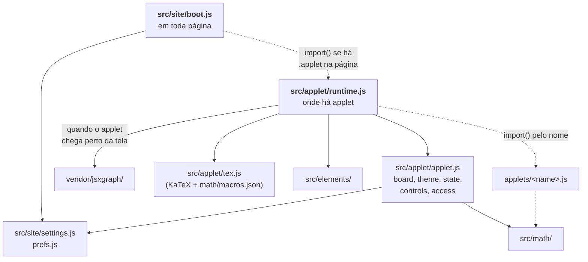
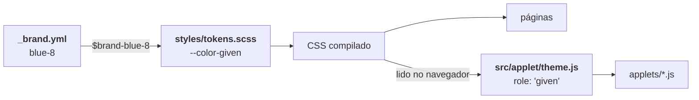

# Mapa arquitetural do projeto

Guia para quem está chegando ao projeto, inclusive quem tem pouca experiência
com desenvolvimento web: **como o projeto se organiza**, **o caminho que o texto
de um capítulo percorre até virar uma página publicada**, **como se verifica** e
**como fazer as tarefas comuns**.

**O que cada arquivo faz está num comentário no início dele.** Este mapa não
repete esses comentários: diz onde procurar e guarda a visão de conjunto. Se o
mapa e o código divergirem, vale o código, e o mapa é corrigido na mesma mudança.
O sistema veio do `livro-base`, pelas fases da migração (desde 2026-11-22); o
Apêndice A de lá, "Organização do material", é o original deste mapa.

Os diagramas usam [Mermaid](https://mermaid.js.org/): aparecem desenhados no
GitHub e no VS Code com a extensão *Markdown Preview Mermaid Support*.

Documentos relacionados: `README.md` (comandos), `guia-editorial.md` (como
escrever capítulos), `diretrizes-tecnicas.md` (como desenvolver e decidir),
`decisoes.md` (por que as coisas são como são) e `pendencias.md` (o que está
em aberto).

---

## 1. Visão geral

Os capítulos são escritos em **Markdown com extensões do Quarto (`.qmd`)**; o
**Quarto** converte esses arquivos em **páginas HTML** (com estilos, fórmulas e
applets) dentro da pasta `docs/`; um **robô do GitHub (GitHub Actions)** faz
isso automaticamente a cada `git push` na `main` e publica o resultado no
**GitHub Pages**. Num pull request, o robô faz as mesmas verificações, mas não
publica.


As ideias que organizam tudo:

1. **O arquivo que se edita é o que o estudante recebe.** Não há compilação de JavaScript nem servidores alheios: o JSXGraph, o KaTeX e as fontes vêm com o site, em `vendor/`. O Quarto é a única ferramenta necessária para gerar o site.
2. **Cada coisa num só lugar.** As cores ficam em `_brand.yml`; os papéis, em `styles/tokens.scss`; a notação, em `math/macros.json`; a escrita dos números, em `src/math/format.js`.
3. **Só se baixa o que se usa.** Uma página de texto não baixa JSXGraph nem KaTeX; um applet é baixado quando chega perto da tela.
4. **O applet diz só o que é dele.** Quadros ligados, redesenho, reinício, descrição, teclado, alternativas ao arraste e tamanhos vêm prontos.

## 2. Glossário mínimo

| Termo | O que é, neste projeto |
|---|---|
| **Quarto** | Programa que transforma `.qmd` em site. Lê a configuração em `_quarto.yml`. |
| **`.qmd`** | Arquivo de texto em Markdown, com fórmulas LaTeX (`$x^2$`) e blocos especiais (`::: {#def-…}`). É onde se escreve o livro. |
| **Filtro Lua** | Pequeno programa que modifica o documento durante a conversão (ex.: `filters/blocks.lua`). |
| **SCSS** | CSS com variáveis e regras aninhadas, compilado pelo Quarto. |
| **Variável CSS** (`--color-…`) | Valor definido uma vez e reutilizado em todo o site e pelos applets. |
| **JSXGraph** | Biblioteca de geometria dinâmica dos applets. |
| **Elemento** | O que `board.create(tipo, pais, atributos)` cria no JSXGraph. Os elementos novos do livro (`handle`, `vector`…) ficam em `src/elements/`. |
| **KaTeX** | Biblioteca que desenha as fórmulas. As do texto são desenhadas quando o site é gerado; o KaTeX só vai ao navegador quando um applet o pede. |
| **Perfil lab** | O laboratório: `quarto render --profile lab` acrescenta as páginas de `laboratorio/` e grava em `docs-lab/`, que não vai ao ar. |

## 3. As pastas

Legenda: ✏️ editado à mão · ⚙️ configuração · 🏭 gerado automaticamente (não
editar, não versionado) · 🔒 local (não vai para o Git)

```text
livro-quarto/
├── _quarto.yml                 ⚙️  O livro: capítulos, tema, filtros, cabeçalho, menu, resources
├── _quarto-lab.yml             ⚙️  Perfil lab: acrescenta a parte Laboratório e grava em docs-lab/
├── _quarto-axe.yml             ⚙️  Perfil axe: a verificação de acessibilidade do Quarto, no console
├── _brand.yml                  ⚙️  Paleta de cores, fontes, tamanho e entrelinha do texto
├── _language.yml               ⚙️  Traduções de rótulos ("Demonstração", "Solução"…)
├── index.qmd, acessibilidade.qmd ✏️  A Apresentação e o que cada opção do painel faz
├── README.md, AGENTS.md        ✏️  Resumo e comandos; resumo das diretrizes para assistentes de IA
├── cspell.json                 ⚙️  Corretor ortográfico (pt-BR + termos técnicos)
│
├── capitulos/                  ✏️  Um .qmd por capítulo publicado (ordem em _quarto.yml)
├── laboratorio/                ✏️  Páginas de teste e modelos de capítulo, só no perfil lab
├── assets/img/<capítulo>/      ✏️  Figuras, uma subpasta por capítulo
│
├── filters/                    ✏️  Filtros Lua: macros, blocos, fórmulas comentadas, applets
├── math/macros.json            ✏️  As macros LaTeX (\vet, \norm, \R…): a lista, lida por todos
├── tools/                      ✏️  Depois do render: desenha as fórmulas; as seções no menu
├── styles/                     ✏️  SCSS; os valores ficam em tokens.scss e _brand.yml
├── src/                        ✏️  O que roda no navegador, sem compilação
│   ├── site/                   ✏️  Em toda página: preferências, painel, abas, menu
│   ├── applet/                 ✏️  Onde há applet: quadro, estado, controles, alternativas ao arraste
│   ├── elements/               ✏️  Os elementos novos do JSXGraph
│   └── math/                   ✏️  Contas e escrita de números, sem desenho
├── applets/                    ✏️  Um arquivo por applet; o nome do arquivo é o nome usado no capítulo
├── vendor/                     JSXGraph, KaTeX, fontes e o recorte de ícones (versões e licenças em VERSIONS.md)
│
├── tests/                      ✏️  check-site.mjs, browser.mjs, unit/ (§6)
│
├── _interno/                   ✏️  Material interno, ignorado pelo Quarto (começa com "_")
│   ├── diretrizes/             ✏️  Princípios, guia editorial, diretrizes técnicas, decisões, pendências, este mapa
│   ├── referencia/             ✏️  Material anterior aos Princípios, que não orienta o trabalho atual
│   └── oficina/                ✏️  Os capítulos antigos (nao-publicados/) e a bibliografia, inativa
│
├── .github/workflows/publish.yml ⚙️  Robô de verificação e publicação
├── docs/, docs-lab/            🏭  Os sites gerados (só docs/ vai ao ar)
├── tests/node_modules/, tests/output/ 🏭  O que npm ci instala; as capturas de tela dos testes do navegador
└── _scratch/, .claude/         🔒  Rascunhos; configurações locais do Claude Code
```

Os arquivos de `src/`, `filters/`, `styles/`, `tools/` e `tests/` vêm do
`livro-base`, iguais a menos dos comentários (uma diferença maior está escrita
no alto do arquivo). Uma mudança neles começa no `livro-base` e chega aqui à mão.

**Regra prática:** uma pasta com 🏭 pode ser apagada sem medo, porque é recriada
pelo comando correspondente. Nunca edite arquivos dentro de `docs/`: a alteração
some na próxima geração.

## 4. O caminho de uma página

**1. Ao gerar o site** (`quarto render`), quatro filtros Lua trabalham sobre o
texto: `blocks.lua` (antes do Quarto) põe os rótulos e faz as abas das dicas e
soluções; `macros.lua` expande as macros de `math/macros.json`, em qualquer
formato de saída; `annotations.lua` prepara as fórmulas comentadas;
`applet.lua` transforma o bloco `.applet` em HTML simples e põe
`src/site/boot.js` em toda página. `resources`, em `_quarto.yml`, copia para
`docs/` os módulos de `src/`, os applets, `vendor/` e `math/macros.json`, como
estão.

**2. Depois de gerar** (`post-render`), `tools/prerender-math.ts` desenha as
fórmulas (o leitor nunca vê TeX cru) e `tools/sidebar-sections.ts` põe as seções
de cada capítulo no menu lateral.

**3. No navegador, em toda página:** `src/site/apply-prefs.html`, no `<head>`,
aplica as preferências antes de a página aparecer; `boot.js` liga o painel de
acessibilidade, as abas e a seção atual no menu, e só carrega o resto onde há
uso (`annotations.js` numa fórmula comentada; `src/applet/runtime.js` onde há
applet).

**4. Quando um applet chega perto da tela**, `runtime.js` baixa o JSXGraph, o
KaTeX, os elementos novos e `applets/<name>.js`, que recebe `addBoard`,
`makeState`, `addSlider`… e desenha. Uma preferência que muda o desenho remonta o
applet, com o que o estudante já fez.



O `name` do bloco precisa ser **igual** ao nome do arquivo do applet
(`applets/scalar-multiple.js`, sem `.js`). Se não for, o render avisa, a página
mostra "Não foi possível carregar este applet" e a verificação acusa erro.

## 5. Cores: de `_brand.yml` até o applet

Uma cor é definida **uma única vez**. Para mudar a cor dos dados, por exemplo,
altere a paleta ou o token, e não o JavaScript.



| Papel | Cor | Uso pedagógico |
|---|---|---|
| `--color-given` | `blue-8` | O que o estudante controla ou o que o enunciado fornece |
| `--color-result` | `orange-2` | O que o applet calcula a partir dos dados, foco da ideia |
| `--color-support` | `gray-5` | Construções que ajudam a ler: cópias, projeções, linhas de chamada (tracejadas) |

Nomes, origem e pontos de referência usam a cor do texto. Erro ou contraexemplo
não tem cor própria (`role: 'alert'` muda o traço). A paleta de `_brand.yml`
tem as **cores do livro**, as únicas que os papéis usam, e as **cores de teste**,
do JSX-quarto (`blue-oi`, `red-tb`…), que um applet de teste chama pelo nome.

## 6. As verificações

As três do `livro-base`. As duas primeiras separam erros, que impedem a
publicação, de avisos.

`node --test "tests/unit/*.test.mjs"`
:   A paleta (nenhuma das 82 cores se perdeu), as macros, as contas das fórmulas comentadas e as de `src/math/`. Só precisa do Node.

`node tests/check-site.mjs`, depois de `quarto render --to html`
:   Nas fontes: imagens que não existem, títulos usados como definições, TeX mal escrito, os nomes do código na prosa (questão E16 do livro-base), os blocos e a marcação dos applets de antes da migração. No site gerado: `alt`, `title`, applets sem arquivo ou sem nome lido, o que os applets carregam e não chegou ao site, ids repetidos, títulos, links internos e âncoras, fórmulas que ficaram sem desenhar, pedidos a outros servidores (também nas folhas de estilo), o contraste dos papéis sobre o quadro. Com `--lab`, as páginas de `docs-lab/laboratorio/`, como erro; a exceção é `laboratorio/teste.qmd`, o experimento das setas, cujas fórmulas que o KaTeX não desenha são só listadas. Com `--strict`, os avisos também reprovam. O que fazer com cada mensagem: Apêndice B do livro-base, "Quando algo dá errado".

`(cd tests && npm ci && node browser.mjs)`, depois de `quarto render --profile lab --to html`
:   O site no Chrome: larguras de 320 a 1920 px, cabeçalho, menu, painel, abas, fórmulas comentadas e, nos applets, arraste, teclado, toque, campos, animação, reiniciar, menos movimento, contraste alto e o console; o axe-core (WCAG 2.2 A e AA) em toda página. Lê o site do laboratório (`docs-lab/`), que tem as páginas do site público e as do laboratório, onde estão os applets. Vem do livro-base, adaptado às páginas daqui: as verificações dos applets que o livro não tem ficaram lá. Leva alguns minutos; grava capturas de tela em `tests/output/`, para olhar.

No GitHub (`.github/workflows/publish.yml`), a cada pull request e a cada push na
`main`: os testes de unidade, o render e as verificações do livro e do laboratório,
e os testes do navegador, com as capturas de tela guardadas na página da
verificação; só então, e só num push na `main`, a publicação. Um erro para tudo, e o
site anterior continua no ar.

## 7. Trabalho local: qual comando usar

| Quero… | Comando | Onde |
|---|---|---|
| Ver o livro enquanto escrevo | `quarto preview` | raiz |
| Ver o laboratório (páginas de teste e modelos de capítulo) | `quarto preview --profile lab` (com `--profile lab,axe`, também a verificação de acessibilidade do Quarto, no console) | raiz |
| Editar um applet e ver no livro | `quarto preview --profile lab`, com o applet numa página do laboratório. A prévia não copia um `.js` salvo: salve também a página que o usa | raiz |
| Gerar e verificar o site | `quarto render --to html` e `node tests/check-site.mjs` | raiz |
| Gerar e verificar o laboratório | `quarto render --profile lab --to html` e `node tests/check-site.mjs --lab` | raiz |
| Rodar os testes de unidade | `node --test "tests/unit/*.test.mjs"` | raiz |
| Rodar os testes do navegador, depois de gerar o laboratório (sem editar nada enquanto rodam) | `npm ci` (uma vez) e `node browser.mjs`; uma verificação só: `node browser.mjs "trecho do nome"` | `tests/` |

## 8. Receitas comuns

### Adicionar um capítulo
1. Copiar um dos modelos de `laboratorio/` (`modelo-capitulo-completo.qmd` ou `modelo-capitulo.qmd`) para `capitulos/<nome>.qmd`, com um único título `#`, e trocar os rótulos (`#def-…`, `#exr-…`).
2. Incluir `capitulos/<nome>.qmd` em `book.chapters` no `_quarto.yml`, na posição desejada.
3. Imagens em `assets/img/<nome>/`, referenciadas por `../assets/img/<nome>/arquivo.png`.
4. Rodar `quarto preview` e, depois de `quarto render --to html`, `node tests/check-site.mjs`.

### Adicionar um applet JSXGraph
O que o applet deve garantir, a ficha de aceitação e como reescrever um applet
GeoGebra estão em `diretrizes-tecnicas.md`, §4. A ficha de cada função e de cada
elemento novo está no Apêndice C do livro-base ("Guia de autoria de applets").

1. Criar `applets/<nome>.js`, com o nome em inglês e minúsculas, separado por
   hífens: é o nome usado no capítulo. A exportação padrão recebe o que o applet
   usa e diz só o que é dele. Nas primeiras linhas, um comentário com o que o
   applet mostra e as partes que o capítulo pode pôr. Esqueleto, do
   `scalar-multiple.js`:

   ```js
   // O vetor u, com a ponta arrastável, e o vetor a·u, com uma faixa de valores para a.
   // Partes: `plane`; as expressões `product` e `a`; e os controles.

   import { tex, text } from '../src/math/format.js';
   import { scale } from '../src/math/vec.js';

   export default function ({ addBoard, makeState, addSlider, addLive, addStatus }) {
     const s = makeState({ a: 1.5 });
     const plane = addBoard('plane', { spoken: 'Os vetores u e a vezes u', region: [-5, 4, 5, -4], axis: true, grid: true });
     const U = plane.create('handle', [2, 1], { arrowTip: true, spoken: 'ponta de u', caption: '$\\vec{u}$', snapToGrid: true });
     const u = () => [U.X(), U.Y()];
     const au = () => scale(s.a, u());

     plane.create('vector', [[0, 0], au], { role: 'result', name: 'a\\vec{u}', side: 'right' });
     plane.create('vector', [[0, 0], U], { name: '\\vec{u}' });

     addSlider('a', { min: -2, max: 2, step: 0.1 });
     addLive('product', () => `a\\vec{u} = ${tex.point(au())}`);
     addStatus(() => `a = ${text.number(s.a)}, u = ${text.point(u())} e a vezes u = ${text.point(au())}.`);
   }
   ```

   A figura, a expressão e a descrição leem a mesma conta (regra fundamental 1).
   Os valores iniciais do `makeState` e dos pontos são também os do reinício.
2. Testar numa página de `laboratorio/` (listada em `_quarto-lab.yml`), com
   `quarto preview --profile lab`; com `show="fields"` (ou `"tapMove"`) no bloco,
   a página mostra a alternativa ao arraste sem mexer nas preferências do leitor.
3. `quarto render --profile lab --to html`, `node tests/check-site.mjs --lab` e,
   em `tests/`, `node browser.mjs`.
4. No capítulo, com a instrução num parágrafo antes:
   `::: {.applet name="<nome>" spoken="Nome para o leitor de tela"}` e `:::`
   (`guia-editorial.md`, §6).

### Adicionar um applet com várias partes
Quadros ligados e expressões em lugares diferentes da página: o mesmo arquivo,
com um `addBoard` por quadro e um `addLive` por expressão, cada um com o nome da
parte. Um quadro que o capítulo pode deixar de fora leva `optional: true`, e
`addBoard` devolve `null` quando ele não está na página:

```js
const line = addBoard('number', { spoken: 'O número a na reta numérica', optional: true, region: [-2.5, 1, 2.5, -1] });
if (line) line.create('point', [() => s.a, 0], { color: 'given', name: 'a', withLabel: true });
```

Os boards de um applet se redesenham juntos; os que mostram o mesmo plano levam
`shareScale(a, b)`. No capítulo, as partes e os arranjos estão no
`guia-editorial.md`, §6, e na página Arranjos do laboratório.

### Adicionar controles a um applet
Faixas de valores, caixas de seleção, botões de opção, campos e botões, ligados
ao estado (`makeState`), na ordem em que devem aparecer, que é também a do Tab:

```js
const s = makeState({ a: 1.5, showLine: false });
addSlider('a', { min: -2, max: 2, step: 0.1 });
addCheckbox('showLine', { caption: 'mostrar a reta de $\\vec{u}$' });
addPlayButton(makeAnimation('a', { min: -2, max: 2, speed: 1 }));
plane.create('line', [[0, 0], U], { role: 'support', visible: () => s.showLine });
```

O nome lido pelo leitor de tela vem do nome do valor (`a`) ou do `caption`, em
texto simples. Um campo de digitar ao lado da faixa de valores não se escreve:
quem prefere digitar o escolhe no painel.

### Mudar uma cor
- Cor do tema (fundo, links, títulos): papel ou paleta em `_brand.yml`.
- Cor de um papel dos applets (site e applets): token `--color-…` em `styles/tokens.scss`, e a do contraste alto, logo abaixo, no mesmo arquivo. A verificação avisa se um papel cair abaixo de 3:1 sobre o quadro.

### Testar cores num applet
1. No applet, peça as cores pelo nome da paleta de `_brand.yml`: `{ color: 'blue-oi' }`, junto do papel, que dá o traço (`{ role: 'result', color: 'teal-oi' }`).
2. Use o applet numa página de `laboratorio/` e veja-a com `quarto preview --profile lab`. Um nome errado deixa o elemento sem a cor pedida: confira na página.
3. Antes de o applet ir para um capítulo, troque as cores pelos papéis (`role`); se a cor testada deve ficar, isso é uma decisão (`diretrizes-tecnicas.md`, §6). A verificação avisa se um applet de capítulo pedir uma cor de teste.
4. Para comparar modelos de cor, use a página `teste-cores.qmd` (a lista `models` de `applets/color-models.js`).

### Criar um novo tipo de bloco didático
Antes, ver se uma `.note` com outro título não basta: o título diz o que o trecho é,
e não há uma lista fixa de tipos de aviso.
1. Rótulo em `labels` de `filters/blocks.lua`.
2. Estilo em `styles/blocks.scss`, junto ao `.objective` e à `.note`.
3. Documentar em `guia-editorial.md` e acrescentar aos modelos de `laboratorio/`.
4. Registrar a decisão em `decisoes.md` (`diretrizes-tecnicas.md`, §2). O filtro vem
   do livro-base: um bloco novo vale também lá, ou fica como diferença escrita no
   alto do arquivo.

## 9. Pontos de atenção

- **O laboratório é o mesmo livro.** `_quarto-lab.yml` só acrescenta a parte Laboratório e a pasta `docs-lab/`; tema, filtros e macros vêm de `_quarto.yml`, sem cópia. Por isso, um rótulo (`#def-…`, `#exr-…`) de um capítulo igual a um de `laboratorio/` se repete no perfil lab: ao copiar um modelo para `capitulos/`, troque os rótulos.
- **Uma pasta nova de páginas** precisa de um `_metadata.yml` com o caminho do KaTeX (`../vendor/katex/`), como `capitulos/` e `laboratorio/`: o de `_quarto.yml` é relativo à página.
- **Nome do applet = nome do arquivo.** Código que dois applets usam não fica em `applets/`: vai para `src/` (um elemento novo, em `src/elements/`, só se dois applets precisarem dele e ele significar uma ideia só).
- **Os arquivos de `resources`.** O Quarto copia para `docs/` o que `resources` lista, sem acusar o que falta; sem `math/macros.json` ou sem o JSXGraph, nenhum applet aparece. A verificação confere que chegaram. Os padrões começam com `/`: sem a barra, `docs/` iria parar dentro de `docs-lab/`.
- **Nomes lidos diferentes.** Dois quadros com o mesmo nome na mesma página confundem quem navega pelo leitor de tela (o axe acusa).
- **Cores e medidas lidas na montagem.** `src/applet/theme.js` lê as variáveis CSS quando o applet é montado; uma preferência do painel que as muda remonta os applets.
- **Toque.** No quadro, o dedo fora dos pontos rola a página, e sobre um ponto o arrasta (`src/applet/board.js`): um applet que crie o board sem `addBoard` perde esse cuidado.
- **Depuração no navegador.** No console, `bookApplets` (um `Map`) tem os applets montados da página, com o estado e os boards de cada um.
- **A prévia e os arquivos `.js`.** `quarto preview` não copia de novo um arquivo de `src/` ou `applets/` que foi salvo: salve também a página que o usa, ou rode `quarto render`. Com a prévia aberta, não rode os testes do navegador: ela refaz páginas no meio deles.
- **`docs/` acumula arquivos antigos** (vários `bootstrap-*.min.css`) entre renderizações locais. É normal; o robô publica a partir de uma pasta limpa.
- **Erros de SCSS.** Quando a compilação do tema falha, o Quarto pode deixar na raiz `_quarto_internal_scss_error.scss`, para diagnóstico; está no `.gitignore` e pode ser apagado depois de corrigido o erro.
- **`quarto render --profile lab --to typst`** apaga o HTML de `docs-lab/` (deixa só o PDF): renderize o HTML de novo depois.
