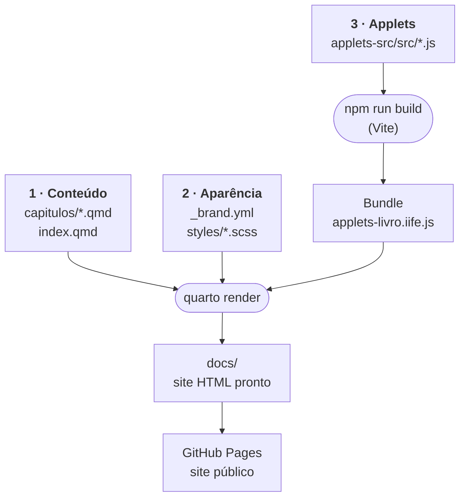
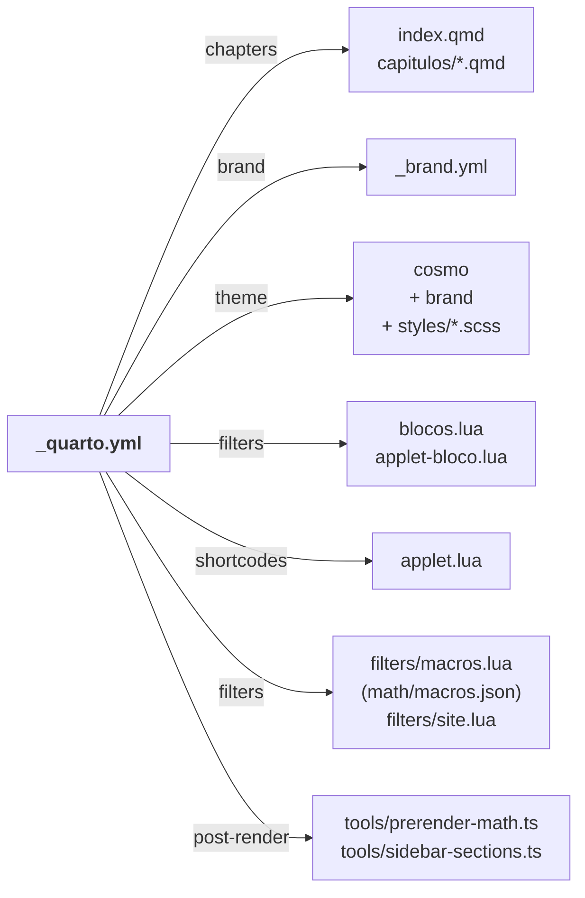
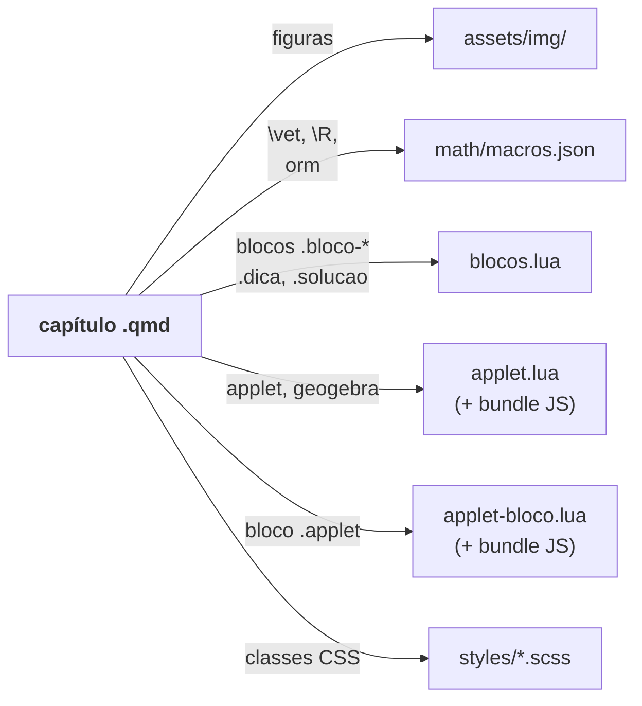
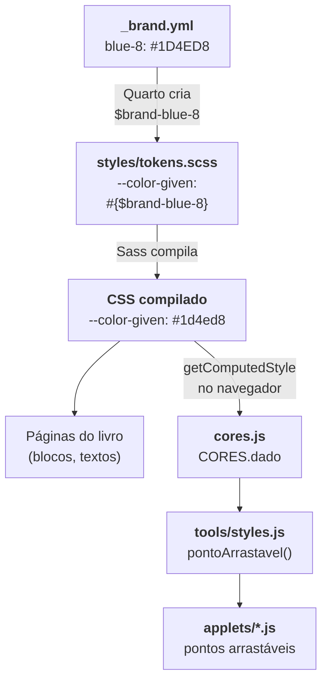
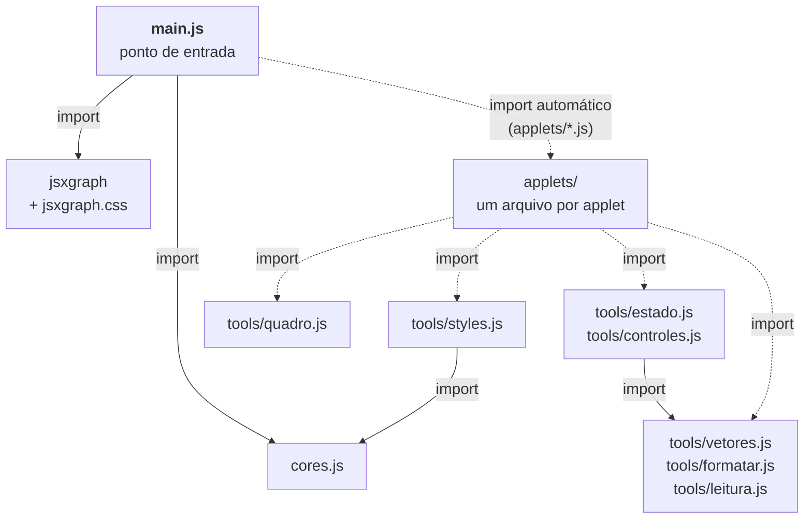
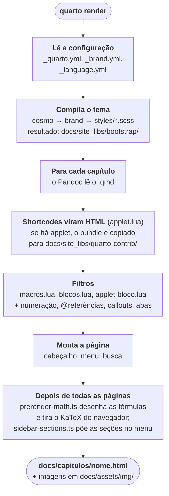
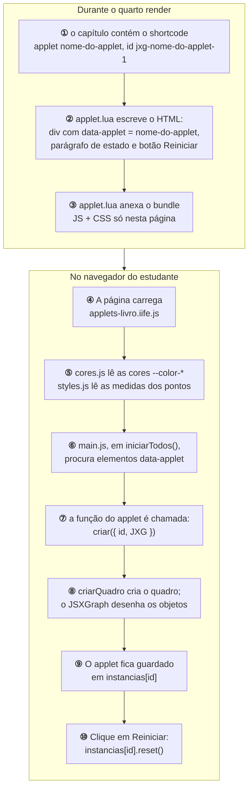
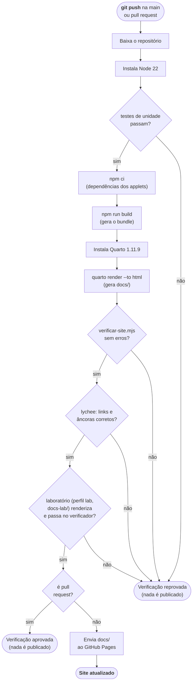
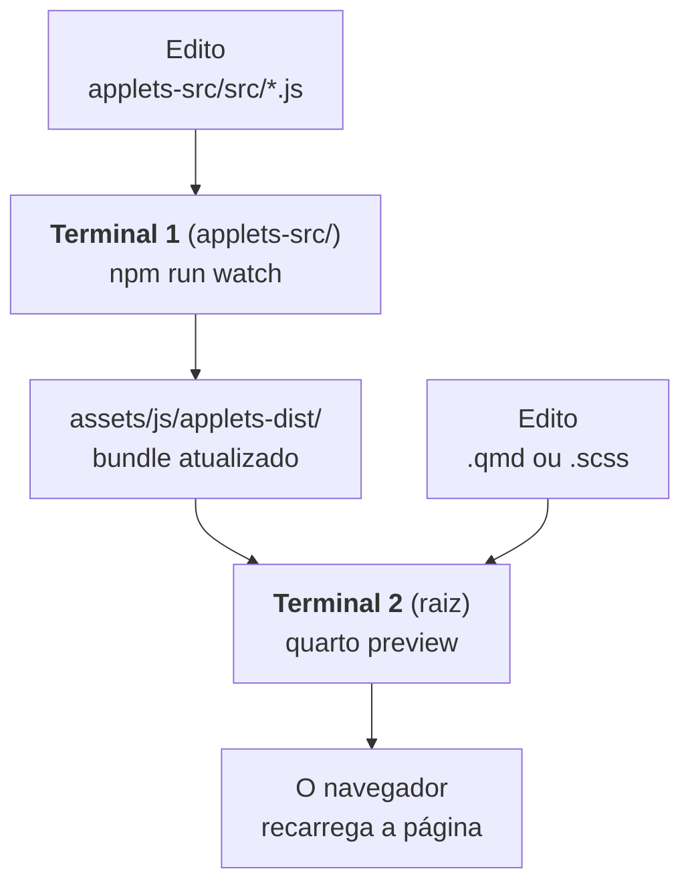

# Mapa arquitetural do projeto

Guia para quem está chegando ao projeto, inclusive quem tem pouca experiência
com desenvolvimento web. Explica **o que cada pasta e arquivo faz**, **como os
arquivos dependem uns dos outros** e **o caminho que o texto de um capítulo
percorre até virar uma página publicada**.

Os diagramas usam [Mermaid](https://mermaid.js.org/): aparecem desenhados no
GitHub e no VS Code com a extensão *Markdown Preview Mermaid Support*.

Este mapa descreve o projeto **como ele é hoje**. Quando o código muda, o mapa
é atualizado na mesma mudança; se os dois divergirem, vale o código.

Documentos relacionados: `README.md` (comandos), `guia-editorial.md` (como
escrever capítulos), `diretrizes-tecnicas.md` (como desenvolver e decidir),
`decisoes.md` (por que as coisas são como são) e `pendencias.md` (o que está
em aberto).

---

## 1. Visão geral em uma frase

Os capítulos são escritos em **Markdown com extensões do Quarto (`.qmd`)**; o
**Quarto** converte esses arquivos em **páginas HTML** (com estilos, fórmulas e
applets) dentro da pasta `docs/`; um **robô do GitHub (GitHub Actions)** faz
isso automaticamente a cada `git push` na `main` e publica o resultado no
**GitHub Pages**. Num pull request, o robô faz as mesmas verificações, mas não
publica.

Há três "linhas de montagem" que se encontram no final:



---

## 2. Glossário mínimo

| Termo | O que é, neste projeto |
|---|---|
| **Quarto** | Programa que transforma `.qmd` em site. Lê a configuração em `_quarto.yml`. |
| **`.qmd`** | Arquivo de texto em Markdown, com fórmulas LaTeX (`$x^2$`) e blocos especiais (`::: {#def-…}`). É onde se escreve o livro. |
| **Pandoc** | Conversor de documentos usado internamente pelo Quarto. Os filtros Lua atuam sobre ele. |
| **Filtro Lua** | Pequeno programa em Lua que modifica o documento durante a conversão (ex.: `components/blocos.lua`). |
| **Shortcode** | Atalho do tipo `` dentro do `.qmd`, que é trocado por HTML na conversão (definido em `components/applet.lua`). |
| **SCSS / Sass** | CSS com variáveis e regras aninhadas. É compilado para CSS comum pelo Quarto. |
| **Bootstrap / Cosmo** | Biblioteca de estilos usada pelo Quarto; *Cosmo* é o tema-base escolhido. |
| **Variável CSS** (`--color-…`) | Valor definido uma vez em `:root` e reutilizado em todo o site e pelos applets. |
| **JSXGraph** | Biblioteca JavaScript de geometria dinâmica usada nos applets próprios. |
| **Vite** | Ferramenta que junta (*empacota*) vários arquivos JS em um só arquivo, o **bundle**. |
| **IIFE** | Formato do bundle: um único `.js` que roda direto no navegador, sem `import`. Expõe o objeto global `AppletsLivro`. |
| **npm / `package.json`** | Gerenciador de pacotes do Node.js; baixa o JSXGraph e o Vite para `node_modules/`. |
| **KaTeX** | Biblioteca que desenha as fórmulas LaTeX. As fórmulas do texto são desenhadas quando o site é gerado (`tools/prerender-math.ts`, depois do render), e não no navegador de cada leitor; o KaTeX só vai ao navegador nas páginas com applet, que o usam, de `vendor/katex/`, que vem com o site (`html-math-method` em `_quarto.yml`). |
| **GitHub Actions** | Robô que executa `.github/workflows/publish.yml` a cada push na `main` (verifica e publica) e a cada pull request para a `main` (só verifica). |
| **GitHub Pages** | Hospedagem gratuita do GitHub que serve o conteúdo de `docs/` como site. |

---

## 3. Árvore de pastas

Legenda: ✏️ editado à mão · ⚙️ configuração · 🏭 gerado automaticamente (não
editar, não versionado) · 🔒 local (não vai para o Git)

```text
livro-quarto/
├── _quarto.yml                 ⚙️  Configuração central do livro (capítulos, tema, filtros)
├── _quarto-lab.yml             ⚙️  Perfil lab: acrescenta a parte Laboratório e grava em docs-lab/
├── _brand.yml                  ⚙️  Identidade visual: paleta de cores e fontes
├── _language.yml               ⚙️  Traduções de rótulos ("Demonstração", "Solução"…)
├── index.qmd                   ✏️  Página inicial (Apresentação)
├── README.md                   ✏️  Resumo do projeto e comandos
├── AGENTS.md                   ✏️  Resumo das diretrizes para assistentes de IA
├── cspell.json                 ⚙️  Corretor ortográfico (pt-BR + termos técnicos)
│
├── capitulos/                  ✏️  Um .qmd por capítulo publicado (ordem definida em _quarto.yml)
├── laboratorio/                ✏️  Páginas de teste e modelos de capítulo, só no perfil lab
│                                   (nas duas pastas, _metadata.yml: o caminho do KaTeX)
│
├── components/                 ✏️  Extensões do Quarto feitas para o livro
│   ├── applet.lua              ✏️  Shortcodes  e 
│   ├── applet-bloco.lua        ✏️  Filtro: bloco ::: {.applet} de um applet com várias partes
│   ├── applet-comum.lua        ✏️  O que os dois acima têm em comum (bundle, estado, botão Reiniciar)
│   └── blocos.lua              ✏️  Filtro: rótulos dos blocos didáticos e abas Dica/Resolução/Resposta
│
├── filters/
│   ├── macros.lua              ✏️  Filtro: expande as macros em toda fórmula (vem do livro-base)
│   └── site.lua                ✏️  Filtro: põe src/site/boot.js em toda página
├── math/macros.json            ✏️  As macros LaTeX (\vet, \norm, \R…): a lista, lida por todos
├── tools/
│   ├── prerender-math.ts       ✏️  Depois do render: desenha as fórmulas (vem do livro-base)
│   └── sidebar-sections.ts     ✏️  Depois do render: as seções de cada capítulo no menu (vem do livro-base)
│
├── styles/                     ✏️  Estilos próprios do livro, as camadas do tema depois de _brand.yml
│   ├── tokens.scss             ✏️  As cores pelo que significam e as medidas dos pontos
│   ├── page.scss               ✏️  A página: grade, cabeçalho, menu, fórmulas, tabelas, figuras
│   ├── blocks.scss             ✏️  Blocos didáticos, exemplos, exercícios, avisos, abas
│   └── old-applets.scss        ✏️  O sistema antigo de applets e o GeoGebra (sai na fase 5)
├── src/site/                   ✏️  O que roda em toda página (vem do livro-base, sem o painel)
│   ├── boot.js                 ✏️  Seção atual no menu, ícone que recolhe o menu, nomes em português
│   ├── scrollers.js            ✏️  Fórmula ou tabela que rola dentro da coluna, ao alcance do Tab
│   └── apply-prefs.html        ✏️  No <head>: o menu recolhido, antes de a página aparecer
│
├── assets/                     Arquivos estáticos usados pelas páginas
│   ├── img/<capítulo>/         ✏️  Figuras, uma subpasta por capítulo
│   └── js/applets-dist/        🏭  Bundle dos applets gerado por `npm run build`
│
├── vendor/                     Programas de terceiros que chegam ao estudante, copiados (não editar)
│   ├── VERSIONS.md             ✏️  Versões, licenças e de onde vêm
│   ├── katex/                  KaTeX: script, folha de estilo e fontes das fórmulas
│   ├── fonts/                  Fontes do texto e dos títulos, lidas por _brand.yml
│   └── icons/                  Um recorte da fonte de ícones do Quarto, com os ícones que o livro mostra
│
├── applets-src/                ✏️  Código-fonte dos applets JSXGraph (projeto Node/Vite separado)
│   ├── package.json            ⚙️  Dependências (jsxgraph, vite) e scripts (dev, build, watch)
│   ├── package-lock.json       🏭  Versões exatas instaladas (gerado pelo npm, mas versionado)
│   ├── vite.config.js          ⚙️  Como gerar o bundle e onde salvá-lo
│   ├── index.html              ✏️  Página de testes para `npm run dev` (não faz parte do livro)
│   ├── src/
│   │   ├── main.js             ✏️  Ponto de entrada: registro automático dos applets, inicialização, reinício
│   │   ├── cores.js            ✏️  Lê as variáveis CSS de cor da página
│   │   ├── tools/quadro.js     ✏️  Cria o quadro (região, proporção, toque e teclado) e liga quadros
│   │   ├── tools/leitura.js    ✏️  Leitura: fórmula do applet desenhada pelo KaTeX
│   │   ├── tools/estado.js     ✏️  Estado (valores que o estudante controla) e animação
│   │   ├── tools/controles.js  ✏️  Controles: faixa, caixa de seleção, campo, botões
│   │   ├── tools/styles.js     ✏️  Estilos JSXGraph: pontos (a forma diz se o ponto se move), seta, traços
│   │   ├── tools/vetores.js    ✏️  Contas com vetores (sem desenho)
│   │   ├── tools/formatar.js   ✏️  Escrita de números, pontos, ângulos e expressões (TeX e texto)
│   │   ├── exemplos/           ✏️  Applets de exemplo para `npm run dev` (fora do bundle)
│   │   └── applets/            ✏️  Um arquivo por applet (hoje teste-cores.js e teste-controles.js, das páginas de laboratorio/)
│   └── node_modules/           🏭  Pacotes baixados pelo `npm ci`
│
├── tests/
│   ├── verificar-site.mjs      ✏️  Verificação automática das fontes e do HTML gerado
│   ├── unit/palette.test.mjs   ✏️  Teste de unidade: nenhuma cor da paleta se perdeu (vem do livro-base)
│   └── fixtures/               ✏️  A tabela dos nomes das cores, de antes e de agora
│
├── _interno/                   ✏️  Material interno, versionado mas ignorado pelo Quarto (começa com "_")
│   ├── diretrizes/             ✏️  Princípios, guia editorial, diretrizes técnicas, decisões, pendências, este mapa
│   ├── referencia/             ✏️  Material anterior aos Princípios, que não orienta o trabalho atual
│   └── oficina/
│       ├── nao-publicados/     ✏️  Capítulos ainda fora do índice do livro
│       └── references.bib/.qmd ✏️  Bibliografia (ainda inativa)
│
├── .github/
│   ├── workflows/publish.yml   ⚙️  Robô de build e publicação no GitHub Pages
│   └── copilot-instructions.md ⚙️  Regras para o GitHub Copilot
├── .vscode/settings.json       ⚙️  Preferências do VS Code para este projeto
├── .gitignore                  ⚙️  O que o Git não deve versionar
│
├── docs/                       🏭  Site gerado por `quarto render` (é ele que vai ao ar)
├── docs-lab/                   🏭  Site do perfil lab, com o laboratório (não vai ao ar)
├── .quarto/                    🏭  Cache interno do Quarto
├── _scratch/                   🔒  Rascunhos e auditorias descartáveis
└── .claude/                    🔒  Configurações locais do Claude Code
```

**Regra prática:** se a pasta aparece com 🏭, pode ser apagada sem medo — ela é
recriada pelo comando correspondente. Nunca edite arquivos dentro de `docs/` ou
`assets/js/applets-dist/`: a alteração some na próxima geração.

---

## 4. Finalidade de cada arquivo

### 4.1 Configuração do livro (raiz)

| Arquivo | Finalidade | Quem lê |
|---|---|---|
| `_quarto.yml` | Diz ao Quarto: tipo de projeto (`book`), pasta de saída (`docs`), lista e ordem dos capítulos, o KaTeX de `vendor/katex/` (`html-math-method`, e `resources`, que o copia para `docs/`), camadas de tema (só o claro: `brand: light: _brand.yml`; com `brand: _brand.yml`, o Quarto gera também uma folha escura que nenhuma página usa; depois do Cosmo e de `brand`, as folhas de `styles/`), as larguras da página (`grid`) e nenhuma coluna "Neste capítulo" (`toc: false`), o cabeçalho (`book.navbar`: o ícone que recolhe o menu, o título e a busca) e o menu (`book.sidebar`), filtros (o das macros e o de `src/site/boot.js` num `filters:` de primeiro nível, que vale para qualquer formato; os outros em `format.html`), shortcodes, os passos depois do render (`post-render`: `tools/prerender-math.ts` e `tools/sidebar-sections.ts`), o que as páginas carregam além delas (`resources`: `src/site/*.js` e o KaTeX), numeração de seções, o tipo personalizado `exrr` (Exercício Resolvido) e a faixa de aviso no alto das páginas (`book.announcement`: desde o Quarto 1.11, um livro ignora a faixa de `website`). | Quarto |
| `_brand.yml` | Paleta nomeada, em duas seções: as cores do livro (`blue-2`, `sand-1`…; os nomes do livro-base desde 2026-11-25, com os mesmos valores: `tests/fixtures/livro-colors.json` tem a tabela dos nomes de antes) e as cores de teste, do JSX-quarto (`blue-oi`, `red-tb`…; §5.2); papéis das cores (`primary`, `background`…), fontes (Atkinson Hyperlegible no texto, Source Serif 4 nos títulos), com os arquivos de `vendor/fonts/` (`source: file`), e não do Google, e o tamanho e a entrelinha do texto. O Quarto transforma cada cor da paleta em uma variável SCSS `$brand-<nome>` e numa variável CSS `--brand-<nome>`. | Quarto (camada `brand` do tema) |
| `_language.yml` | Substitui rótulos padrão do Quarto ("Proof" → "Demonstração"). Lido automaticamente por estar na raiz do projeto. | Quarto |
| `capitulos/_metadata.yml`, `laboratorio/_metadata.yml` | O caminho do KaTeX para as páginas dessas pastas (`../vendor/katex/`): o de `_quarto.yml` é relativo à página. Uma pasta nova de páginas precisa do mesmo arquivo. | Quarto |
| `_quarto-axe.yml` | Perfil `axe`: liga a verificação de acessibilidade do Quarto (axe-core) com `quarto preview --profile axe`. O site publicado é gerado sem perfil e não a leva ao estudante. | Quarto |
| `index.qmd` | Primeira página do livro (sem número de capítulo). | Quarto |
| `cspell.json` | Dicionário e padrões ignorados pelo verificador ortográfico do editor. | Extensão Code Spell Checker |

### 4.2 `capitulos/`

Cada `.qmd` é um capítulo. Só é publicado se estiver listado em `book.chapters`
no `_quarto.yml`. O cabeçalho diz o estado do capítulo (`estado: prototipo` ou
`estado: revisado`; `diretrizes-tecnicas.md`, §1.4), que o verificador lê; a
linha não aparece na página. Um capítulo combina:

- **Markdown** (títulos `##`, listas, ênfase);
- **LaTeX** entre `$…$`, usando as macros de `math/macros.json`;
- **Blocos numerados do Quarto**: `{#def-…}`, `{#prp-…}`, `{#exm-…}`, `{#exr-…}`, `{#exrr-…}`, referenciados com `@def-…`;
- **Blocos didáticos do livro**: `.bloco-objetivo`, `.bloco-pre-requisitos`, `.bloco-interacao`, `.bloco-erro`, `.bloco-checkpoint`;
- **Abas recolhíveis**: `.dica`, `.solucao`, `.resposta`;
- **Shortcodes**: `` e ``;
- **Figuras** de `assets/img/<capítulo>/`.

### 4.3 `components/`, `filters/`, `math/` e `tools/` — extensões do Quarto

| Arquivo | Quando roda | O que faz |
|---|---|---|
| `applet.lua` | Na renderização, ao encontrar um shortcode | `applet`: gera o `<div data-applet="…">` (com as classes de `arranjo`, se houver), o parágrafo de estado `<id>-status` e o botão "Reiniciar applet"; registra o bundle JS/CSS e o KaTeX **apenas nessa página**. `geogebra`: gera um `<iframe>` acessível (com `title`, carregamento tardio e link alternativo), numa caixa branca (`.bloco-geogebra`) que esconde a sobra branca do iframe. |
| `applet-bloco.lua` | Na renderização, em todo capítulo | Transforma o bloco `::: {.applet nome="…" id="…" rotulo="…"}` na parte interativa de um applet com várias partes: o bloco recebe `data-applet`, `role="group"` e o rótulo; cada parte `.quadro` vira um `div.applet-jxg` com `aria-label`, cada `.leitura`, um `div.applet-leitura`, e cada `.controles`, um `div.applet-controles`; cada parte recebe `data-parte` (o id, sem o prefixo `<id>-`); no fim entram o parágrafo de estado e o botão. Avisa no render quando falta rótulo, quando o id de uma parte não começa por `<id>-` e quando uma parte está fora de um bloco. |
| `applet-comum.lua` | Carregado pelos dois acima (`require`) | Carrega o bundle e o KaTeX de `vendor/katex/` (script, folha e um script que define no próprio KaTeX as macros de `math/macros.json`, para os applets); escreve o parágrafo de estado e o botão "Reiniciar", iguais no shortcode e no bloco. |
| `blocos.lua` | Na renderização, em todo capítulo | Insere o rótulo visível ("Objetivo", "Erro comum"…) no topo de cada `.bloco-*`; agrupa `.dica`/`.solucao`/`.resposta` consecutivas em abas que começam fechadas, e injeta o pequeno script que permite fechá-las. |
| `filters/macros.lua` | Na renderização, em toda fórmula, para qualquer formato de saída | Expande as macros de `math/macros.json` (`\vet`, `\norm`, `\N`, `\Z`, `\Q`, `\R`, `\C`): a fórmula chega ao KaTeX, às prévias das referências cruzadas e ao PDF já em TeX comum. Vem do livro-base, igual. |
| `math/macros.json` | Lido por `filters/macros.lua` e `applet-comum.lua` | A lista das macros, em JSON: cada barra invertida do TeX aparece dobrada (`"\\R": "\\mathbb{R}"`), e `#1` é o argumento. |
| `filters/site.lua` | Na renderização, em toda página HTML | Põe `src/site/boot.js` no fim da página, com o caminho a partir dela (`quarto.project.offset`). No livro-base, quem faz isso é `filters/applet.lua`, que chega na fase 5 da migração. |
| `tools/prerender-math.ts` | Depois do render (`post-render`), com o Deno que vem com o Quarto | Troca cada fórmula pelo desenho do KaTeX (`vendor/katex/katex.min.js`) e tira da página o KaTeX do Pandoc: uma página sem applet não carrega JavaScript para a matemática, e o leitor nunca vê TeX cru. Uma fórmula que o KaTeX não desenha para o render (no laboratório, só fica para o KaTeX do navegador). Vem do livro-base, com as diferenças escritas no alto do arquivo. |
| `tools/sidebar-sections.ts` | Depois do render (`post-render`), depois do anterior | Põe no menu lateral de cada página as seções (os títulos `##`) de cada capítulo, como subitens que se recolhem, no lugar da coluna "Neste capítulo"; um título marcado com `.unlisted` fica de fora. É HTML puro (`<details>`) e funciona sem JavaScript; `src/site/boot.js` só marca a seção que está na tela. Numa prévia parcial, só a página salva é refeita. Vem do livro-base, igual. |

### 4.4 `styles/`, `src/site/` e `assets/`

| Caminho | Finalidade |
|---|---|
| `styles/tokens.scss` | As cores pelo que significam (`--color-text`, `--color-accent`, `--color-given`, `--color-result`, `--color-support`, `--color-board`…), derivadas de `_brand.yml`, e as medidas dos pontos dos applets (`--point-radius`, `--ring-width`…); o site e os applets leem estes nomes. Também tira do Cosmo o pedido da fonte dele ao Google (`$web-font-path: false`). Os nomes são os do livro-base desde 2026-11-25 (eram `--cor-…` e `--applet-…`). |
| `styles/page.scss` | A página: o recorte da fonte de ícones (`vendor/icons/`), o foco, o movimento reduzido, a opacidade dos títulos menores (contraste), a seta de `\vet` (decisão E6 do livro-base), fórmulas e tabelas largas que rolam dentro da coluna, código no meio do texto que quebra a linha, figuras `.fig-leg`, o cabeçalho, as cores dos links de navegação, a grade da página (as larguras de `grid`, em `_quarto.yml`; decisão E4 do livro-base), o menu recolhido e as seções no menu. |
| `styles/blocks.scss` | Blocos didáticos (`.bloco-*`), exemplos e exercícios (com o `exrr`), os avisos do Quarto e as abas recolhíveis das dicas e resoluções. Dá lugar ao `blocks.scss` do livro-base na fase 7. |
| `styles/old-applets.scss` | O sistema antigo de applets: o bloco do applet, o quadro de fundo branco e borda fina, os arranjos (`.estreito`, `.centro`, `.grupo`, o espaço da `.grid`), o `touch-action` do quadro, os controles e o GeoGebra. Sai na fase 5. |
| `src/site/boot.js` | Roda em toda página (`filters/site.lua`): marca no menu a seção que está na tela, dá ao ícone que recolhe o menu o nome do que ele faz e a barra de espaço, leva o `<html>` junto quando o menu se recolhe, tira dos links de anterior e próximo um nome que não bate com o que está na tela e traduz o nome da busca. Vem do livro-base, sem o painel de acessibilidade. |
| `src/site/scrollers.js` | Uma fórmula, tabela ou bloco de código mais largo que a coluna rola dentro dela; este módulo o põe ao alcance do Tab, só quando de fato rola. Vem do livro-base, igual. |
| `src/site/apply-prefs.html` | No `<head>` de toda página (`include-in-header`): marca o menu recolhido antes de a página aparecer, para ela não piscar com o menu aberto. No livro-base, aplica também as preferências do painel. |
| `img/<capítulo>/` | Imagens dos capítulos. O Quarto copia para `docs/assets/img/` as que são usadas. |
| `js/applets-dist/` | 🏭 `applets-livro.iife.js` + `applets-livro.css`, saída do Vite. |

### 4.5 `applets-src/` — applets JSXGraph

| Arquivo | Finalidade |
|---|---|
| `package.json` | Declara as dependências (`jsxgraph`, `vite` e `katex`, este só para a página de desenvolvimento, `index.html`, na versão de `vendor/katex/`) e os scripts: `dev` (servidor de testes), `build` (gera o bundle uma vez), `watch` (regera a cada alteração). |
| `vite.config.js` | Gera **um único arquivo** IIFE chamado `applets-livro.iife.js`, com nome global `AppletsLivro`, em `../assets/js/applets-dist/`. |
| `index.html` | Página de desenvolvimento usada só por `npm run dev`. Repete as cores, as medidas e as regras dos pontos de `styles/tokens.scss` e `styles/old-applets.scss` (e imita a grade do Quarto), que fora do livro não existem (o verificador avisa se uma variável repetida difere da do livro), e traz uma amostra das formas de ponto e das setas, o exemplo de applet com várias partes, no HTML que o bloco gera (nada disso vai para o bundle), e o applet de teste dos controles em dois arranjos, com o essencial do CSS deles. Carrega o KaTeX da dependência de desenvolvimento (`package.json`), sem as macros do livro, para os nomes dos objetos, as leituras e os rótulos dos controles. |
| `src/main.js` | **Ponto de entrada.** Importa o JSXGraph e seu CSS, monta o **registro** `applets` com todos os arquivos de `src/applets/` (o nome do arquivo, sem `.js`, é o nome do applet; a exportação padrão é a função que o cria), procura na página todo elemento com `data-applet` e chama a função correspondente, com as partes do bloco em `partes`; trata os cliques em botões `data-reset`. |
| `src/cores.js` | Lê as variáveis `--color-…` da página (`getComputedStyle`) e as expõe no objeto `CORES`. É a ponte entre o CSS do livro e os applets. `cor(nome)` lê uma variável uma vez e avisa no console quando ela não existe (o objeto ficaria preto); `paleta(nome)` devolve uma cor de `_brand.yml` pelo nome (`paleta("blue-oi")`), para os applets de teste. |
| `src/tools/quadro.js` | `criarQuadro({ JXG, id, regiao, eixos, grade })`: cria o quadro com a proporção da região e os padrões de interação (o plano não se desloca nem muda de escala; no toque, rolar fora dos pontos e arrastar sobre eles; o ponto mais próximo vence; o ponto arrastado não sai da região) e os nomes dos objetos em TeX, desenhados pelo KaTeX da página (16 px, na cor do texto), conferindo o tamanho deles depois de cada atualização, para que o nome de uma seta não encoste nela quando as fontes do KaTeX chegam; só desenha num `.applet-jxg`. `ligarQuadros(...quadros)`: mexer num quadro redesenha os outros. |
| `src/tools/leitura.js` | `criarLeitura({ id, tex, quadros })`: escreve na parte `.leitura` a fórmula `tex()`, desenhada pelo KaTeX da página (com as macros do livro), refeita quando um dos quadros muda; sem KaTeX, mostra o TeX. `desenharTex(elemento, tex)`, o desenho em si, serve também aos controles. |
| `src/tools/estado.js` | `criarEstado(valoresIniciais, ...quadros)`: os valores que o estudante controla, lidos e escritos pela chave (`estado.a`, `estado.a = 2`); mudar um valor redesenha os quadros e avisa os ouvintes (`on`); `reiniciar()` volta tudo ao início e avisa todos. `criarAnimacao(estado, chave, { min, max, velocidade, modo })`: anima um valor (`tocar`, `pausar`, `alternar`, `tocando`, `on`); só começa a pedido e para quando outro código muda o mesmo valor e no reinício. |
| `src/tools/controles.js` | `criarFaixa`, `criarCaixa`, `criarCampo`, `criarBotao` e `criarBotaoAnimacao`: controles em HTML ligados ao estado, com nome fixo para o leitor de tela. O primeiro argumento é a parte `.controles` ou o id do applet; com o id do applet, os controles ficam num contêiner criado logo antes do texto de estado, abaixo do quadro. |
| `src/tools/vetores.js` | Contas com vetores em listas de números (`componentes`, `soma`, `produtoEscalar`, `norma`, `angulo`, `determinante`, `coeficientesNaBase`, `projecao`…); `NaN` quando a conta não está definida. |
| `src/tools/formatar.js` | O único lugar do formato dos números: `numero`, `texto.*` (texto simples, para o parágrafo de estado), `tex.*`, `expressao` e `equacao` (TeX, para fórmulas), `casos`. |
| `src/tools/styles.js` | Estilos prontos para objetos JSXGraph: `pontoArrastavel`, `pontoFixo` e `pontoAberto` (cor e forma como parâmetros; medidas lidas das variáveis de `styles/tokens.scss`, como `--point-radius`), `seta` (ponta e nome no meio, em TeX, com 18 px) e o objeto `ESTILOS` com os traços por papel (`resultado`, `dado`, `apoio`) e o `alerta` (erro ou contraexemplo, sem cor própria, combinado com o estilo do papel). |
| `src/applets/` | Um arquivo por applet; a exportação padrão é a função que o cria (§7). Hoje tem dois applets de teste: `teste-cores.js`, usado na página `laboratorio/teste-cores.qmd` (a soma de vetores no modelo de cor do livro e em duas alternativas, lado a lado), e `teste-controles.js`, usado em `teste-controles.qmd` (o vetor a·u, com faixa, campo, caixa e botão Animar, em quatro arranjos) e em `arranjos.qmd` (todos os arranjos do guia editorial, §6, com as partes opcionais do applet: um segundo quadro, com o número a na reta numérica, e a leitura da conta). O piloto da combinação linear (`combinacao-linear.js` e `piloto-combinacao-linear.qmd`) foi apagado em 2026-11-22 (`decisoes.md`). O livro não tem applet JSXGraph em capítulo desde que o `segmento` foi removido, em 2026-11-03. |
| `src/exemplos/` | Applets de exemplo, fora do bundle (`main.js` só registra `src/applets/`): `exemplo-partes.js`, com dois quadros ligados e uma leitura, é o modelo de applet com várias partes e roda na página de `npm run dev`. |

### 4.6 `tests/verificar-site.mjs`

Script Node. Roda sem instalar nada: confere as fórmulas com `vendor/katex/katex.min.js`, o mesmo arquivo que `tools/prerender-math.ts` usa e que as páginas com applet carregam. Verifica:

- **nas fontes** (`index.qmd`, `capitulos/*.qmd` e `laboratorio/*.qmd`): imagens inexistentes, "Definição"/"Proposição" escritas como título em vez de bloco, comandos TeX suspeitos (ex.: `\MATHBB`), cores `\color{…}` sem `#`;
- **no site gerado** (`docs/`; com `--lab`, `docs-lab/`): `iframe` sem `title`, imagem sem `alt` (aviso), applet usado sem arquivo correspondente em `applets-src/src/applets/`, quadro ou bloco de applet sem rótulo, `id` duplicado (fora dos blocos de código), saltos na hierarquia de títulos (aviso), o que a página carrega de outro servidor, no HTML ou nas folhas de estilo locais que ela carrega (`url()` e `@import`; erro também no laboratório, porque vem da configuração do livro);
- **nas fórmulas** do site gerado, que chegam desenhadas (`tools/prerender-math.ts`), com as macros já expandidas (`filters/macros.lua`): o TeX de cada uma, guardado numa anotação, passa de novo pelo KaTeX, e é aviso se tem um caractere que ele não conhece (como `’` no lugar de `'`); uma fórmula que ficou em TeX é erro: ou o KaTeX não a desenha (comando inexistente, macro com nome errado, `\color[HTML]{…}`), ou o post-render não rodou; e é erro uma página sem applet que ainda carrega o KaTeX no navegador. O resumo conta as fórmulas;
- **nas cores**, a partir do CSS do tema que as páginas de `docs/` carregam (avisos): variável de `applets-src/index.html` com valor diferente do livro; cor lida por `cores.js` (menos a do fundo) com contraste abaixo de 3:1 sobre o fundo do quadro (`--color-board`); applet usado no livro que chama `paleta()`;
- **nos protótipos** (`estado: prototipo` no cabeçalho do `.qmd`; a página de `docs/` é ligada à fonte pelo caminho): continua erro o que quebra a página (imagem inexistente, comando TeX suspeito, fórmula que o KaTeX não desenha, `iframe` sem `title`, applet sem arquivo ou sem rótulo, `id` duplicado); os avisos e a conferência de título de definição ou proposição viram uma linha de contagem ("Em protótipos: N avisos…"), que não reprova nem com `--estrito`. Um valor de `estado` que não seja `prototipo` nem `revisado` gera aviso; sem a linha, a fonte é tratada como revisada.

- **no laboratório** (`laboratorio/`, e as páginas dele em `docs-lab/`): o que o verificador acha é listado à parte ("No laboratório, sem reprovar") e não reprova, nem com `--estrito`: são testes e modelos, alguns com exemplos que não funcionam de propósito (o applet `nome-do-applet`, macros só da página). Sem `--lab`, uma página do laboratório em `docs/` é erro: ela só entra pelo perfil.

Links internos e âncoras são verificados à parte pelo *lychee*, no workflow, só em `docs/`.

### 4.7 Ferramentas e bastidores

| Arquivo | Finalidade |
|---|---|
| `.github/workflows/publish.yml` | Receita do robô de publicação (ver §5.5). |
| `.github/copilot-instructions.md`, `AGENTS.md` | Resumo das diretrizes para assistentes de IA: que tipo de mudança cada um pode fazer e como verificar (`diretrizes-tecnicas.md`, §9). |
| `.vscode/settings.json` | Formatação de `.qmd` pela extensão Quarto, oculta pastas geradas no Explorer, Copilot só em arquivos de código. |
| `.gitignore` | Impede versionar `docs/`, `.quarto/`, `node_modules/`, o bundle, `_scratch/`, HTML gerado em `_interno/` etc. |
| `_quarto-lab.yml` | O perfil lab: o Quarto o junta ao `_quarto.yml` com `--profile lab`. Só acrescenta a parte Laboratório (as páginas de `laboratorio/`, uma por linha) e a pasta de saída `docs-lab/`; o resto da configuração é a do livro. Com `--profile lab,axe`, também a verificação de acessibilidade. |

---

## 5. Diagramas

### 5.1 Quem depende de quem (configuração e estilos)

As setas significam "é lido / usado por".



O `_language.yml` não aparece no `_quarto.yml`: o Quarto o lê
automaticamente por estar na raiz do projeto.

E o que cada capítulo usa, conforme o que está escrito nele:



### 5.2 Cadeia das cores: de `_brand.yml` até o applet

Uma cor é definida **uma única vez** e chega ao site e aos applets por este
caminho. Para mudar a cor dos dados, por exemplo, altere a paleta ou o token
— não o JavaScript.



Papéis de cor dos objetos matemáticos (definidos em `styles/tokens.scss`), um
tom cada:

| Token | Cor | Uso pedagógico |
|---|---|---|
| `--color-given` | `blue-8` | O que o estudante controla ou o que o enunciado fornece (ex.: $\vec u$ e $\vec v$ na soma) |
| `--color-result` | `orange-2` | O que o applet calcula a partir dos dados, foco da ideia (ex.: $\vec u + \vec v$) |
| `--color-support` | `gray-5` | Construções que ajudam a ler: cópias, projeções, linhas de chamada (tracejadas) |

Nomes, origem e pontos de referência usam a cor do texto (`--color-text`). Erro
ou contraexemplo não tem cor própria: o objeto mantém a cor do papel e recebe
`ESTILOS.alerta` (traço grosso, tracejado curto), e o texto de estado explica.
Dois objetos do mesmo papel se distinguem pelo nome junto a eles.

A paleta de `_brand.yml` tem duas seções: as **cores do livro**, as únicas que
os tokens acima usam, e as **cores de teste**, que são as paletas comparadas no
JSX-quarto (Desmos, Okabe–Ito, Tol, IBM Carbon, Dark2), com os nomes de lá:
`<matiz>-<fonte>`, como `blue-oi`. O Quarto cria `--brand-<nome>` para todas.
Um applet de teste chama uma cor pelo nome, com `paleta("blue-oi")`; um applet
usado no livro usa `CORES` (`diretrizes-tecnicas.md`, §4.5 e §6).

### 5.3 Dependências entre os arquivos JavaScript



As setas tracejadas mostram onde um applet novo se encaixa: basta criar o
arquivo em `applets/`, porque `main.js` importa todos os arquivos dessa pasta
(`import.meta.glob`). O Vite parte de `main.js`, segue todos esses `import` e
junta tudo em dois arquivos: `applets-livro.iife.js` e `applets-livro.css`.

Observação: o JSXGraph **não** é importado por cada applet. O `main.js` o
importa uma vez e o entrega a cada applet como parâmetro (`criar<Nome>({ id, JXG, partes })`).

### 5.4 O que acontece em `quarto render` (simplificado)



> **Importante:** o `quarto render` **não** compila os applets. Se o bundle não
> existir em `assets/js/applets-dist/`, rode antes
> `cd applets-src && npm ci && npm run build`.

### 5.5 Como um applet aparece na tela

Exemplo: um capítulo com a linha
``.



O nome passado no shortcode (`nome-do-applet`) precisa ser **igual** ao nome do
arquivo do applet (`applets-src/src/applets/nome-do-applet.js`, sem `.js`). Se não
for, o applet não aparece e o teste `verificar-site.mjs` acusa erro.

Com o bloco `::: {.applet}`, o caminho é o mesmo, com três diferenças: em ②, quem
escreve o HTML é `applet-bloco.lua`, e o `data-applet` fica no bloco que envolve as
partes; em ⑦, a função recebe também `partes`, do nome da parte para o id
(`{ figura: "cl-figura", leitura: "cl-leitura" }`); em ⑧, o applet cria um quadro
por parte `.quadro` e a leitura com `criarLeitura`. Os controles (`tools/controles.js`)
entram em ⑧ nos dois casos: na parte `.controles`, se o capítulo a escreveu, ou logo
abaixo do quadro, antes do texto de estado.

### 5.6 Publicação automática (GitHub Actions)



O resultado aparece na página do pull request, no GitHub. Integre o pull
request à `main` só quando a verificação estiver aprovada.

Como `docs/` e o bundle não são versionados, **o site publicado é sempre
gerado do zero pelo robô**. O que está na sua máquina em `docs/` serve apenas
para pré-visualização.

---

## 6. Trabalho local: qual comando usar

| Quero… | Comando | Onde |
|---|---|---|
| Instalar dependências dos applets (1ª vez) | `npm ci` | `applets-src/` |
| Gerar o bundle dos applets | `npm run build` | `applets-src/` |
| Ver o livro enquanto escrevo | `quarto preview` | raiz |
| Ver o livro com a verificação de acessibilidade do Quarto (axe, no console do navegador) | `quarto preview --profile axe` | raiz |
| Editar applets e ver no livro | `npm run watch` (num terminal) + `quarto preview` (noutro) | `applets-src/` e raiz |
| Testar um applet fora do livro | `npm run dev` (abre `index.html`) | `applets-src/` |
| Gerar o site completo | `quarto render` | raiz |
| Rodar as verificações | `node tests/verificar-site.mjs` | raiz |
| Rodar os testes de unidade | `node --test tests/unit/` | raiz |
| Ver as páginas de teste e os modelos de capítulo (laboratório) | `quarto preview --profile lab` (com `--profile lab,axe`, também a verificação de acessibilidade) | raiz |
| Gerar e verificar o laboratório | `quarto render --profile lab --to html` e `node tests/verificar-site.mjs --lab` | raiz |



---

## 7. Receitas comuns

### Adicionar um capítulo
1. Criar `capitulos/<nome>.qmd` com um único título `#`.
2. Incluir `capitulos/<nome>.qmd` em `book.chapters` no `_quarto.yml`, na posição desejada.
3. Imagens em `assets/img/<nome>/`, referenciadas por `../assets/img/<nome>/arquivo.png`.
4. Rodar `quarto preview` e `node tests/verificar-site.mjs`.

### Adicionar um applet JSXGraph
O que o applet deve garantir, a ficha de aceitação e como reescrever um applet
GeoGebra estão em `diretrizes-tecnicas.md`, §4. Os passos técnicos:

1. Criar `applets-src/src/applets/<nome>.js` com a exportação padrão `export default function criar<Nome>({ id, JXG })`, que devolve `{ board, objetos, reset }`. O registro é automático: o nome do arquivo é o nome do applet. Nessa pasta só ficam applets; código compartilhado vai para `src/tools/`. Esqueleto:

   ```js
   import { criarQuadro } from "../tools/quadro.js";
   import { pontoArrastavel } from "../tools/styles.js";
   import { texto } from "../tools/formatar.js";

   export default function criarNome({ id, JXG }) {
     const board = criarQuadro({ JXG, id, regiao: [-1, 5, 7, -1], eixos: true, grade: true });
     if (!board) return null;

     const A0 = [1, 1];   // posição inicial, reaproveitada pelo reset()
     const A = board.create("point", A0, { name: "A", ...pontoArrastavel(), snapToGrid: true });
     // … demais objetos, com os estilos de tools/styles.js e os nomes em TeX ("\\vec{u}")

     // Texto de estado (§4.4 das diretrizes), refeito 400 ms depois do último movimento
     const status = document.getElementById(`${id}-status`);
     let espera;
     const descrever = () => { status.textContent = `A = ${texto.ponto(A)}.`; };
     if (status) {
       descrever();
       board.on("update", () => { clearTimeout(espera); espera = setTimeout(descrever, 400); });
     }

     function reset() {
       A.moveTo(A0);
       board.update();
     }

     return { board, objetos: { A }, reset };
   }
   ```

   O `segmento.js`, modelo até 2026-11-03, continua no histórico do Git: `git show d5b3f8d:applets-src/src/applets/segmento.js`.
2. Opcional: acrescentar um `div` de teste em `applets-src/index.html` e usar `npm run dev`.
3. `npm run build`.
4. No capítulo, dentro de um `.bloco-interacao`: ``.

### Adicionar um applet com várias partes
Quadros ligados e leituras em lugares diferentes da página. O modelo é
`applets-src/src/exemplos/exemplo-partes.js`, que roda em `npm run dev`.

1. No capítulo, um bloco envolve as partes, nos arranjos do `guia-editorial.md`, §6:

   ```markdown
   ::::: {.applet nome="<nome>" id="<id>" rotulo="Descrição do applet"}
   :::: {.grid}
   ::: {#<id>-figura .quadro .g-col-12 .g-col-md-6 rotulo="Descrição do quadro"}
   :::
   ::: {#<id>-leitura .leitura .g-col-12 .g-col-md-6}
   :::
   ::::
   :::::
   ```

2. No applet, as partes chegam em `partes`, pelo nome (o id sem o prefixo `<id>-`). Uma parte que o capítulo não pôs fica de fora, e o applet a trata como opcional:

   ```js
   export default function criarNome({ id, JXG, partes }) {
     const board = criarQuadro({ JXG, id: partes.figura, regiao: [-1, 5, 7, -1] });
     if (!board) return null;
     const outro = partes.outro ? criarQuadro({ JXG, id: partes.outro, regiao: [-1, 5, 7, -1] }) : null;
     if (outro) ligarQuadros(board, outro);
     criarLeitura({ id: partes.leitura, tex: () => `…`, quadros: [board] });
     // texto de estado em `${id}-status` e reset(), como no applet de um quadro
   }
   ```

3. `npm run build`, `quarto render` e `node tests/verificar-site.mjs`; o render avisa quando falta um rótulo ou quando o id de uma parte não começa por `<id>-`.

### Adicionar controles a um applet
Faixas, caixas de seleção, campos e botões. O modelo é
`applets-src/src/applets/teste-controles.js`, que roda em `npm run dev` e na página
`laboratorio/teste-controles.qmd`.

1. No applet, os valores que o estudante controla ficam num estado, e a figura os lê por funções:

   ```js
   import { criarAnimacao, criarEstado } from "../tools/estado.js";
   import { criarBotaoAnimacao, criarCaixa, criarCampo, criarFaixa } from "../tools/controles.js";
   import { tex } from "../tools/formatar.js";

   const estado = criarEstado({ a: 1, reta: false }, board);   // valores iniciais e quadros
   board.create("point", [() => estado.a, 0], { … });
   board.create("line", [A, B], { visible: () => estado.reta, … });
   ```

2. Os controles, na ordem em que devem aparecer (e em que a tecla Tab passa). O primeiro argumento diz onde ficam: a parte `.controles`, se o capítulo a escreveu, ou o id do applet, que os põe logo abaixo do quadro:

   ```js
   const onde = partes.controles ?? id;
   criarFaixa(onde, estado, "a", { min: -2, max: 2, passo: 0.1, nome: "a", tex: (a) => `a = ${tex.numero(a)}` });
   criarCampo(onde, estado, "a", { rotulo: "digite $a$:", nome: "digite a", min: -2, max: 2 });
   criarCaixa(onde, estado, "reta", { rotulo: "mostrar a reta", nome: "mostrar a reta" });
   const animacao = criarAnimacao(estado, "a", { min: -2, max: 2, velocidade: 1 });
   criarBotaoAnimacao(onde, animacao);
   ```

   `nome` é o que o leitor de tela lê, em texto simples, e vale sempre; num rótulo com fórmula (`$…$`), ele é obrigatório. Dois controles da mesma página não devem ter o mesmo nome.
3. No `reset()`, `estado.reiniciar()` volta os valores, os controles e a animação; os pontos voltam com `moveTo`, como antes.
4. No capítulo, nada muda se os controles ficam abaixo do quadro; para outro lugar, a parte `.controles` (`guia-editorial.md`, §6).

### Mudar uma cor
- Cor do tema (fundo, links, títulos): papel ou paleta em `_brand.yml`.
- Cor de um objeto matemático (site e applets): token `--color-…` em `styles/tokens.scss`.
- Se mudar um token usado pelos applets, atualize também o `:root` de `applets-src/index.html` (só afeta a página de testes); o verificador avisa se os valores ficarem diferentes.

### Testar cores num applet
1. Escreva o applet em `src/applets/` e chame as cores pelo nome da paleta de `_brand.yml`: `import { paleta } from "../cores.js";` e `seta(paleta("blue-oi"), { nome: "\\vec{u}" })`. Valem as cores do livro (`orange-2`) e as de teste (`red-tb`, `purple-cb`…).
2. Use o applet numa página de `laboratorio/` (listada em `_quarto-lab.yml`) e veja-a com `quarto preview --profile lab`, depois de `npm run build`.
3. Um nome errado aparece no console do navegador ("Cor não encontrada") e deixa o objeto preto. No console, `AppletsLivro.paleta("blue-oi")` mostra o valor de uma cor.
4. A página de `npm run dev` não tem as variáveis `--brand-…`: ali, `paleta()` dá preto. Teste as cores no laboratório.
5. Antes de o applet ir para um capítulo, troque `paleta()` pelas cores dos papéis (`CORES`); se a cor testada deve ficar, isso é uma decisão (`diretrizes-tecnicas.md`, §6).
6. Para comparar modelos de cor, use a página `teste-cores.qmd`: as cores de cada modelo estão na função `modelos()` de `src/applets/teste-cores.js`.

### Criar um novo tipo de bloco didático
1. Rótulo em `rotulos` de `components/blocos.lua`.
2. Estilo em `styles/blocks.scss`, junto aos demais `.bloco-*`.
3. Documentar em `_interno/diretrizes/guia-editorial.md` e acrescentar aos
   modelos de `laboratorio/`.
4. Registrar a decisão em `decisoes.md` (`diretrizes-tecnicas.md`, §2).

---

## 8. Pontos de atenção

- **O laboratório é o mesmo livro.** `_quarto-lab.yml` só acrescenta a parte Laboratório e a pasta `docs-lab/`; tema, filtros e macros vêm de `_quarto.yml`, sem cópia. Por isso, um rótulo (`#def-…`, `#exrr-…`) de um capítulo igual a um de `laboratorio/` se repete no perfil lab: ao copiar um modelo para `capitulos/`, troque os rótulos.
- **Nome do applet = nome do arquivo.** `main.js` registra cada arquivo de `src/applets/`, e o teste usa a mesma regra. Um arquivo auxiliar posto nessa pasta seria tomado por applet: código compartilhado fica em `src/tools/`.
- **`id` único por página.** Cada applet usa `id` como chave em `instancias` e para achar `<id>-status`. Dois applets com o mesmo `id` na mesma página quebram ambos.
- **Rótulos diferentes.** O JSXGraph faz de cada quadro uma região com nome; dois quadros com o mesmo rótulo na mesma página confundem quem navega pelo leitor de tela (o axe acusa).
- **A grade do Quarto e a largura de 320 px.** A `.grid` tem 12 colunas e 11 espaços entre elas; com o espaço padrão (1,5 rem), só os espaços já passavam da coluna a 320 px. `styles/old-applets.scss` o reduz para 1 rem. Uma parte na grade ou no grupo também pode ficar mais estreita que o desenho já feito (`min-width: 0`), para o JSXGraph redesenhar o quadro quando a janela estreita.
- **Applets e KaTeX.** As fórmulas do texto saem desenhadas (`tools/prerender-math.ts`), e o KaTeX do Pandoc sai das páginas; mas os nomes dos objetos, as leituras e os rótulos dos controles dos applets são desenhados no navegador, pelo KaTeX da página. Por isso `applet-comum.lua` põe o KaTeX de `vendor/katex/` nas páginas com applet: o script, a folha e as macros, cada um numa dependência (o Quarto 1.11 perde um a cada dois elementos do `head` de uma dependência só), e o script antes da folha (o Quarto cerca o primeiro script do KaTeX com as linhas que guardam o `window.define`, e põe a de volta antes da primeira folha). Até a fase 5 da migração, que traz os applets do livro-base. Fórmulas longas rolam dentro da leitura a 320 px, como as fórmulas em destaque do texto (`.katex-display`, em `styles/page.scss`): prefira leituras curtas.
- **Macros no KaTeX.** Nas fórmulas do texto, as macros já vêm expandidas (`filters/macros.lua`). Para os applets, `applet-comum.lua` as define no KaTeX da página com `katex.__defineMacro`, a função que as extensões do KaTeX usam, mas que não é pública, no `DOMContentLoaded` (numa página sem o post-render, o KaTeX do Pandoc chega depois e toma o lugar do outro). Ao trocar a versão do KaTeX (os arquivos de `vendor/katex/` e a linha de `vendor/VERSIONS.md`; e, para a página de desenvolvimento, `applets-src/package.json`), o verificador acusa erro se ela sumir, e o console da página avisa.
- **Cores e medidas lidas uma vez.** `cores.js` e `tools/styles.js` leem as variáveis CSS quando o bundle carrega. Mudanças de cor ou de medida exigem recarregar a página.
- **Toque.** O `touch-action` do quadro (`.applet-jxg`, em `styles/old-applets.scss`) tem `!important` porque o JSXGraph escreve outro valor no quadro a cada toque, com um toque de atraso; quem impede a rolagem quando o dedo pega um ponto é `criarQuadro`. Um applet que crie o quadro sem `criarQuadro` perde esse cuidado.
- **Depuração no navegador.** O bundle expõe o global `AppletsLivro`. No console: `AppletsLivro.instancias` lista os applets ativos; `AppletsLivro.resetarApplet("<id>")` reinicia um deles.
- **`docs/` acumula arquivos antigos** (vários `bootstrap-*.min.css`) entre renderizações locais. É normal; o robô publica a partir de uma pasta limpa. Para limpar localmente, apague `docs/` e renderize de novo.
- **Pastas com `_` no início** (`_interno/`, `_scratch/`) são ignoradas pelo Quarto; por isso o material interno não aparece no site.
- **Erros de SCSS.** Quando a compilação do tema falha, o Quarto pode deixar na raiz um arquivo `_quarto_internal_scss_error.scss` para diagnóstico. Ele é temporário, está no `.gitignore` e pode ser apagado depois de corrigido o erro.
