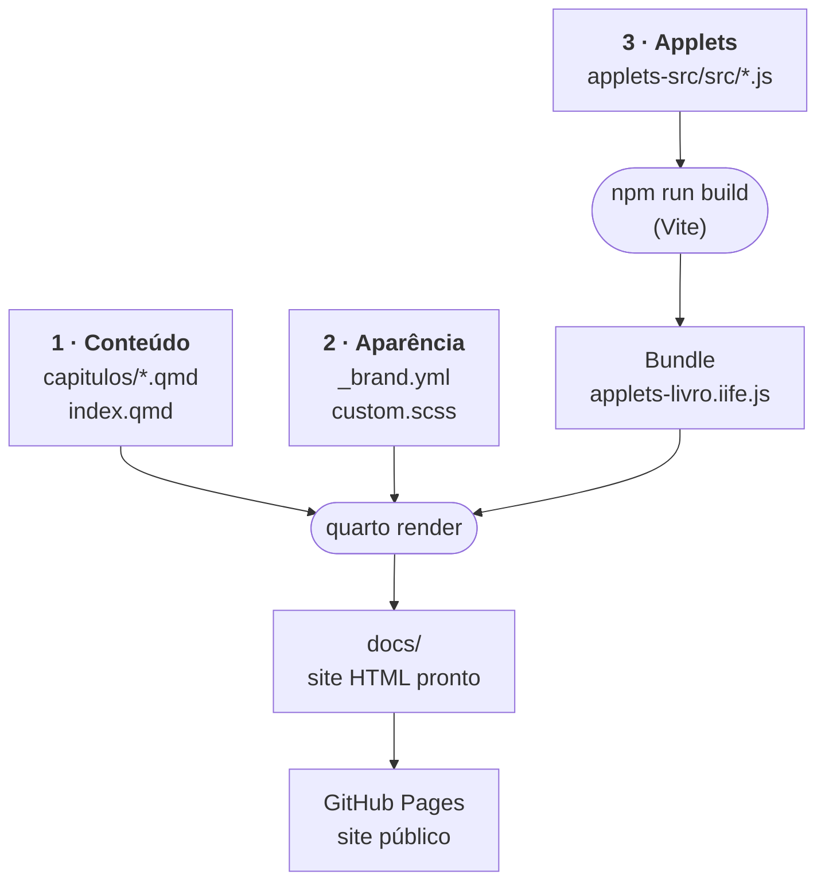
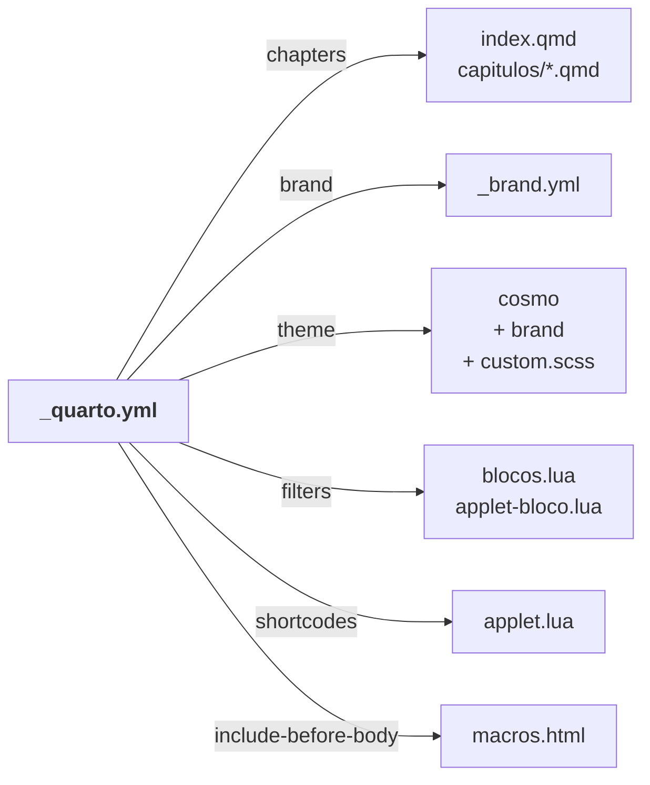
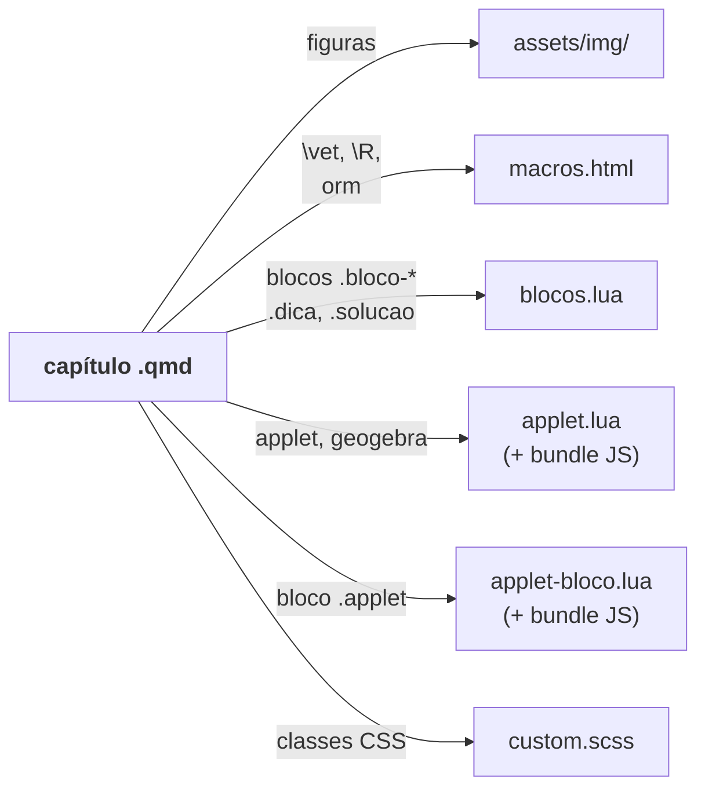
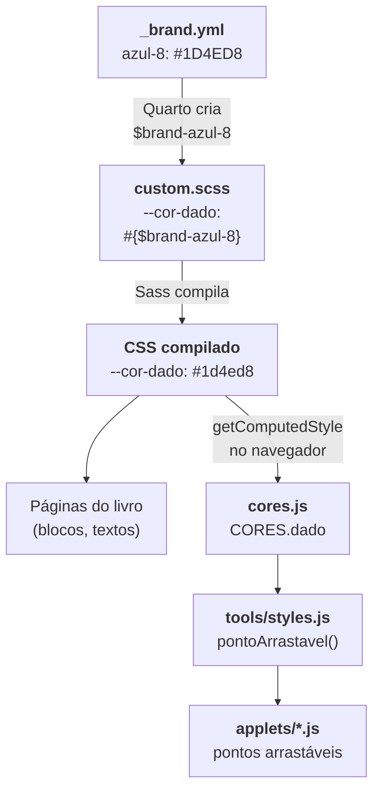
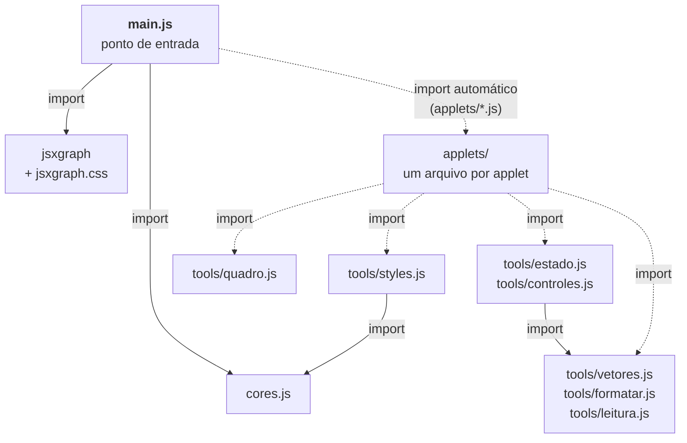
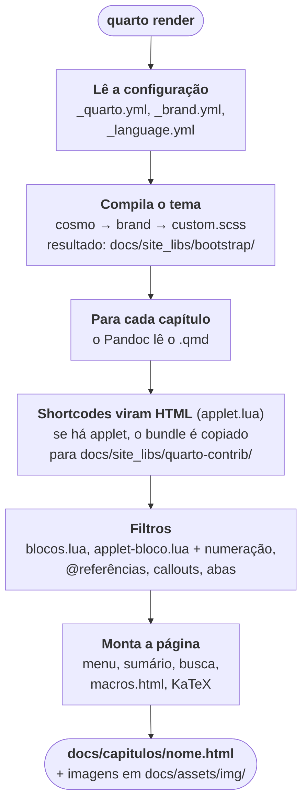
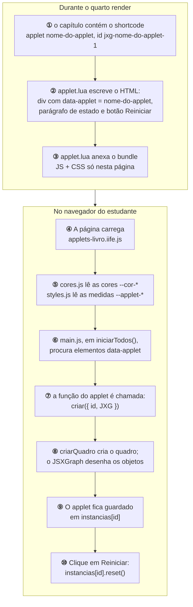
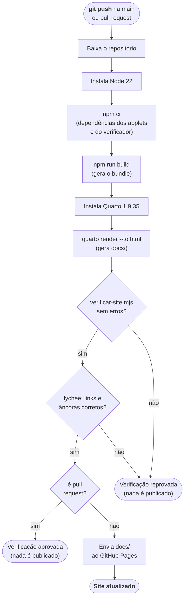
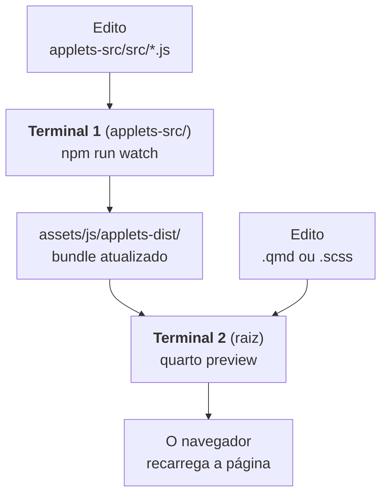

# Mapa arquitetural do projeto

Guia para quem está chegando ao projeto, inclusive quem tem pouca experiência
com desenvolvimento web. Explica **o que cada pasta e arquivo faz**, **como os
arquivos dependem uns dos outros** e **o caminho que o texto de um capítulo
percorre até virar uma página publicada**.

Os diagramas usam [Mermaid](https://mermaid.js.org/): aparecem desenhados no
GitHub e no VS Code com a extensão *Markdown Preview Mermaid Support*.

Este mapa descreve o projeto **como ele é hoje**. Quando o código muda, o mapa
é atualizado na mesma mudança; se os dois divergirem, vale o código.

Documentos relacionados: `README.md` (comandos), `guia-editorial.md` (como
escrever capítulos), `diretrizes-tecnicas.md` (como desenvolver e decidir),
`decisoes.md` (por que as coisas são como são) e `pendencias.md` (o que está
em aberto).

---

## 1. Visão geral em uma frase

Os capítulos são escritos em **Markdown com extensões do Quarto (`.qmd`)**; o
**Quarto** converte esses arquivos em **páginas HTML** (com estilos, fórmulas e
applets) dentro da pasta `docs/`; um **robô do GitHub (GitHub Actions)** faz
isso automaticamente a cada `git push` na `main` e publica o resultado no
**GitHub Pages**. Num pull request, o robô faz as mesmas verificações, mas não
publica.

Há três "linhas de montagem" que se encontram no final:



---

## 2. Glossário mínimo

| Termo | O que é, neste projeto |
|---|---|
| **Quarto** | Programa que transforma `.qmd` em site. Lê a configuração em `_quarto.yml`. |
| **`.qmd`** | Arquivo de texto em Markdown, com fórmulas LaTeX (`$x^2$`) e blocos especiais (`::: {#def-…}`). É onde se escreve o livro. |
| **Pandoc** | Conversor de documentos usado internamente pelo Quarto. Os filtros Lua atuam sobre ele. |
| **Filtro Lua** | Pequeno programa em Lua que modifica o documento durante a conversão (ex.: `components/blocos.lua`). |
| **Shortcode** | Atalho do tipo `` dentro do `.qmd`, que é trocado por HTML na conversão (definido em `components/applet.lua`). |
| **SCSS / Sass** | CSS com variáveis e regras aninhadas. É compilado para CSS comum pelo Quarto. |
| **Bootstrap / Cosmo** | Biblioteca de estilos usada pelo Quarto; *Cosmo* é o tema-base escolhido. |
| **Variável CSS** (`--cor-…`) | Valor definido uma vez em `:root` e reutilizado em todo o site e pelos applets. |
| **JSXGraph** | Biblioteca JavaScript de geometria dinâmica usada nos applets próprios. |
| **Vite** | Ferramenta que junta (*empacota*) vários arquivos JS em um só arquivo, o **bundle**. |
| **IIFE** | Formato do bundle: um único `.js` que roda direto no navegador, sem `import`. Expõe o objeto global `AppletsLivro`. |
| **npm / `package.json`** | Gerenciador de pacotes do Node.js; baixa o JSXGraph e o Vite para `node_modules/`. |
| **KaTeX** | Biblioteca que desenha as fórmulas LaTeX no navegador. O Pandoc a carrega, só nas páginas com fórmulas, na versão fixada em `_quarto.yml` (`html-math-method`). |
| **GitHub Actions** | Robô que executa `.github/workflows/publish.yml` a cada push na `main` (verifica e publica) e a cada pull request para a `main` (só verifica). |
| **GitHub Pages** | Hospedagem gratuita do GitHub que serve o conteúdo de `docs/` como site. |

---

## 3. Árvore de pastas

Legenda: ✏️ editado à mão · ⚙️ configuração · 🏭 gerado automaticamente (não
editar, não versionado) · 🔒 local (não vai para o Git)

```text
livro-quarto/
├── _quarto.yml                 ⚙️  Configuração central do livro (capítulos, tema, filtros)
├── _brand.yml                  ⚙️  Identidade visual: paleta de cores e fontes
├── _language.yml               ⚙️  Traduções de rótulos ("Demonstração", "Solução"…)
├── index.qmd                   ✏️  Página inicial (Apresentação)
├── README.md                   ✏️  Resumo do projeto e comandos
├── AGENTS.md                   ✏️  Resumo das diretrizes para assistentes de IA
├── cspell.json                 ⚙️  Corretor ortográfico (pt-BR + termos técnicos)
│
├── capitulos/                  ✏️  Um .qmd por capítulo publicado (ordem definida em _quarto.yml)
│
├── components/                 ✏️  Extensões do Quarto feitas para o livro
│   ├── applet.lua              ✏️  Shortcodes  e 
│   ├── applet-bloco.lua        ✏️  Filtro: bloco ::: {.applet} de um applet com várias partes
│   ├── applet-comum.lua        ✏️  O que os dois acima têm em comum (bundle, estado, botão Reiniciar)
│   ├── blocos.lua              ✏️  Filtro: rótulos dos blocos didáticos e abas Dica/Resolução/Resposta
│   └── macros.html             ✏️  Macros LaTeX (\vet, \norm, \R…) incluídas em todas as páginas
│
├── assets/                     Arquivos estáticos usados pelas páginas
│   ├── css/custom.scss         ✏️  Estilos próprios do livro (tokens de cor, blocos, applets)
│   ├── img/<capítulo>/         ✏️  Figuras, uma subpasta por capítulo
│   └── js/applets-dist/        🏭  Bundle dos applets gerado por `npm run build`
│
├── applets-src/                ✏️  Código-fonte dos applets JSXGraph (projeto Node/Vite separado)
│   ├── package.json            ⚙️  Dependências (jsxgraph, vite) e scripts (dev, build, watch)
│   ├── package-lock.json       🏭  Versões exatas instaladas (gerado pelo npm, mas versionado)
│   ├── vite.config.js          ⚙️  Como gerar o bundle e onde salvá-lo
│   ├── index.html              ✏️  Página de testes para `npm run dev` (não faz parte do livro)
│   ├── src/
│   │   ├── main.js             ✏️  Ponto de entrada: registro automático dos applets, inicialização, reinício
│   │   ├── cores.js            ✏️  Lê as variáveis CSS de cor da página
│   │   ├── tools/quadro.js     ✏️  Cria o quadro (região, proporção, toque e teclado) e liga quadros
│   │   ├── tools/leitura.js    ✏️  Leitura: fórmula do applet desenhada pelo KaTeX
│   │   ├── tools/estado.js     ✏️  Estado (valores que o estudante controla) e animação
│   │   ├── tools/controles.js  ✏️  Controles: faixa, caixa de seleção, campo, botões
│   │   ├── tools/styles.js     ✏️  Estilos JSXGraph: pontos (a forma diz se o ponto se move), seta, traços
│   │   ├── tools/vetores.js    ✏️  Contas com vetores (sem desenho)
│   │   ├── tools/formatar.js   ✏️  Escrita de números, pontos, ângulos e expressões (TeX e texto)
│   │   ├── exemplos/           ✏️  Applets de exemplo para `npm run dev` (fora do bundle)
│   │   └── applets/            ✏️  Um arquivo por applet (hoje teste-cores.js e teste-controles.js, do projeto de testes)
│   └── node_modules/           🏭  Pacotes baixados pelo `npm ci`
│
├── tests/
│   └── verificar-site.mjs      ✏️  Verificação automática das fontes e do HTML gerado
│
├── _interno/                   ✏️  Material interno, versionado mas ignorado pelo Quarto (começa com "_")
│   ├── diretrizes/             ✏️  Princípios, guia editorial, diretrizes técnicas, decisões, pendências, este mapa
│   └── oficina/
│       ├── protótipos/         ✏️  Capítulos ainda não publicados
│       ├── testes/             ⚙️  Mini-projeto Quarto com a mesma configuração do livro
│       └── references.bib/.qmd ✏️  Bibliografia (ainda inativa)
│
├── .github/
│   ├── workflows/publish.yml   ⚙️  Robô de build e publicação no GitHub Pages
│   └── copilot-instructions.md ⚙️  Regras para o GitHub Copilot
├── .vscode/settings.json       ⚙️  Preferências do VS Code para este projeto
├── .gitignore                  ⚙️  O que o Git não deve versionar
│
├── docs/                       🏭  Site gerado por `quarto render` (é ele que vai ao ar)
├── .quarto/                    🏭  Cache interno do Quarto
├── _scratch/                   🔒  Rascunhos e auditorias descartáveis
└── .claude/                    🔒  Configurações locais do Claude Code
```

**Regra prática:** se a pasta aparece com 🏭, pode ser apagada sem medo — ela é
recriada pelo comando correspondente. Nunca edite arquivos dentro de `docs/` ou
`assets/js/applets-dist/`: a alteração some na próxima geração.

---

## 4. Finalidade de cada arquivo

### 4.1 Configuração do livro (raiz)

| Arquivo | Finalidade | Quem lê |
|---|---|---|
| `_quarto.yml` | Diz ao Quarto: tipo de projeto (`book`), pasta de saída (`docs`), lista e ordem dos capítulos, camadas de tema, filtros, shortcodes, macros, numeração de seções, o tipo personalizado `exrr` (Exercício Resolvido) e a faixa de aviso no alto das páginas (`website.announcement`: fica em `website`, e não em `book`, porque o Quarto 1.9.35 não leva `book.announcement` ao site). | Quarto |
| `_brand.yml` | Paleta nomeada, em duas seções: as cores do livro (`azul-2`, `areia-1`…) e as cores de teste, do JSX-quarto (`blue-oi`, `red-tb`…; §5.2); papéis das cores (`primary`, `background`…) e fontes (Atkinson Hyperlegible no texto, Source Serif 4 nos títulos). O Quarto transforma cada cor da paleta em uma variável SCSS `$brand-<nome>` e numa variável CSS `--brand-<nome>`. | Quarto (camada `brand` do tema) |
| `_language.yml` | Substitui rótulos padrão do Quarto ("Proof" → "Demonstração"). Lido automaticamente por estar na raiz do projeto. | Quarto |
| `index.qmd` | Primeira página do livro (sem número de capítulo). | Quarto |
| `cspell.json` | Dicionário e padrões ignorados pelo verificador ortográfico do editor. | Extensão Code Spell Checker |

### 4.2 `capitulos/`

Cada `.qmd` é um capítulo. Só é publicado se estiver listado em `book.chapters`
no `_quarto.yml`. Um capítulo combina:

- **Markdown** (títulos `##`, listas, ênfase);
- **LaTeX** entre `$…$`, usando as macros de `components/macros.html`;
- **Blocos numerados do Quarto**: `{#def-…}`, `{#prp-…}`, `{#exm-…}`, `{#exr-…}`, `{#exrr-…}`, referenciados com `@def-…`;
- **Blocos didáticos do livro**: `.bloco-objetivo`, `.bloco-pre-requisitos`, `.bloco-interacao`, `.bloco-erro`, `.bloco-checkpoint`;
- **Abas recolhíveis**: `.dica`, `.solucao`, `.resposta`;
- **Shortcodes**: `` e ``;
- **Figuras** de `assets/img/<capítulo>/`.

### 4.3 `components/` — extensões do Quarto

| Arquivo | Quando roda | O que faz |
|---|---|---|
| `applet.lua` | Na renderização, ao encontrar um shortcode | `applet`: gera o `<div data-applet="…">` (com as classes de `arranjo`, se houver), a fórmula invisível que faz a página carregar o KaTeX, o parágrafo de estado `<id>-status` e o botão "Reiniciar applet"; registra o bundle JS/CSS **apenas nessa página**. `geogebra`: gera um `<iframe>` acessível (com `title`, carregamento tardio e link alternativo), numa caixa branca (`.bloco-geogebra`) que esconde a sobra branca do iframe. |
| `applet-bloco.lua` | Na renderização, em todo capítulo | Transforma o bloco `::: {.applet nome="…" id="…" rotulo="…"}` na parte interativa de um applet com várias partes: o bloco recebe `data-applet`, `role="group"` e o rótulo; cada parte `.quadro` vira um `div.applet-jxg` com `aria-label`, cada `.leitura`, um `div.applet-leitura`, e cada `.controles`, um `div.applet-controles`; cada parte recebe `data-parte` (o id, sem o prefixo `<id>-`); no fim entram a fórmula invisível que faz a página carregar o KaTeX, o parágrafo de estado e o botão. Avisa no render quando falta rótulo, quando o id de uma parte não começa por `<id>-` e quando uma parte está fora de um bloco. |
| `applet-comum.lua` | Carregado pelos dois acima (`require`) | Carrega o bundle e escreve a fórmula invisível que faz a página carregar o KaTeX (uma por applet, escondida pelo CSS), o parágrafo de estado e o botão "Reiniciar", iguais no shortcode e no bloco. |
| `blocos.lua` | Na renderização, em todo capítulo | Insere o rótulo visível ("Objetivo", "Erro comum"…) no topo de cada `.bloco-*`; agrupa `.dica`/`.solucao`/`.resposta` consecutivas em abas que começam fechadas, e injeta o pequeno script que permite fechá-las. |
| `macros.html` | Incluído no `<body>` de todas as páginas | Lista `\vet`, `\norm`, `\N`, `\Z`, `\Q`, `\R`, `\C` (em JSON) e as define no próprio KaTeX assim que ele carrega, antes de as fórmulas serem desenhadas: valem no texto, nas prévias das referências cruzadas e nas leituras dos applets. O verificador lê a mesma lista. |

### 4.4 `assets/`

| Caminho | Finalidade |
|---|---|
| `css/custom.scss` | Última camada do tema. Dividido em `scss:defaults` (variáveis Sass, como tamanho de fonte) e `scss:rules` (regras CSS). Seções: **1. Tokens** (variáveis `--cor-…` derivadas de `_brand.yml`), **2. Layout** (largura da coluna de texto; fórmula em destaque mais larga que a coluna rola dentro dela), componentes (GeoGebra, figuras `.fig-leg`, blocos didáticos, exemplos/exercícios, callouts, abas recolhíveis, applets, com o quadro de fundo branco e borda fina, as medidas `--applet-…` dos pontos, o `touch-action` do quadro e os controles) e **acessibilidade** (`prefers-reduced-motion`). |
| `img/<capítulo>/` | Imagens dos capítulos. O Quarto copia para `docs/assets/img/` as que são usadas. |
| `js/applets-dist/` | 🏭 `applets-livro.iife.js` + `applets-livro.css`, saída do Vite. |

### 4.5 `applets-src/` — applets JSXGraph

| Arquivo | Finalidade |
|---|---|
| `package.json` | Declara as dependências (`jsxgraph`, `vite` e `katex`, este só para o verificador, na versão exata que o livro carrega) e os scripts: `dev` (servidor de testes), `build` (gera o bundle uma vez), `watch` (regera a cada alteração). |
| `vite.config.js` | Gera **um único arquivo** IIFE chamado `applets-livro.iife.js`, com nome global `AppletsLivro`, em `../assets/js/applets-dist/`. |
| `index.html` | Página de desenvolvimento usada só por `npm run dev`. Repete as cores, as medidas e as regras dos pontos de `custom.scss` (e imita a grade do Quarto), que fora do livro não existem (o verificador avisa se uma variável repetida difere da do livro), e traz uma amostra das formas de ponto e das setas, o exemplo de applet com várias partes, no HTML que o bloco gera (nada disso vai para o bundle), e o applet de teste dos controles em dois arranjos, com o essencial do CSS deles. Carrega o KaTeX da dependência de desenvolvimento (`package.json`), sem as macros do livro, para os nomes dos objetos, as leituras e os rótulos dos controles. |
| `src/main.js` | **Ponto de entrada.** Importa o JSXGraph e seu CSS, monta o **registro** `applets` com todos os arquivos de `src/applets/` (o nome do arquivo, sem `.js`, é o nome do applet; a exportação padrão é a função que o cria), procura na página todo elemento com `data-applet` e chama a função correspondente, com as partes do bloco em `partes`; trata os cliques em botões `data-reset`. |
| `src/cores.js` | Lê as variáveis `--cor-…` da página (`getComputedStyle`) e as expõe no objeto `CORES`. É a ponte entre o CSS do livro e os applets. `cor(nome)` lê uma variável uma vez e avisa no console quando ela não existe (o objeto ficaria preto); `paleta(nome)` devolve uma cor de `_brand.yml` pelo nome (`paleta("blue-oi")`), para os applets de teste. |
| `src/tools/quadro.js` | `criarQuadro({ JXG, id, regiao, eixos, grade })`: cria o quadro com a proporção da região e os padrões de interação (o plano não se desloca nem muda de escala; no toque, rolar fora dos pontos e arrastar sobre eles; o ponto mais próximo vence; o ponto arrastado não sai da região) e os nomes dos objetos em TeX, desenhados pelo KaTeX da página (16 px, na cor do texto), conferindo o tamanho deles depois de cada atualização, para que o nome de uma seta não encoste nela quando as fontes do KaTeX chegam; só desenha num `.applet-jxg`. `ligarQuadros(...quadros)`: mexer num quadro redesenha os outros. |
| `src/tools/leitura.js` | `criarLeitura({ id, tex, quadros })`: escreve na parte `.leitura` a fórmula `tex()`, desenhada pelo KaTeX da página (com as macros do livro), refeita quando um dos quadros muda; sem KaTeX, mostra o TeX. `desenharTex(elemento, tex)`, o desenho em si, serve também aos controles. |
| `src/tools/estado.js` | `criarEstado(valoresIniciais, ...quadros)`: os valores que o estudante controla, lidos e escritos pela chave (`estado.a`, `estado.a = 2`); mudar um valor redesenha os quadros e avisa os ouvintes (`on`); `reiniciar()` volta tudo ao início e avisa todos. `criarAnimacao(estado, chave, { min, max, velocidade, modo })`: anima um valor (`tocar`, `pausar`, `alternar`, `tocando`, `on`); só começa a pedido e para quando outro código muda o mesmo valor e no reinício. |
| `src/tools/controles.js` | `criarFaixa`, `criarCaixa`, `criarCampo`, `criarBotao` e `criarBotaoAnimacao`: controles em HTML ligados ao estado, com nome fixo para o leitor de tela. O primeiro argumento é a parte `.controles` ou o id do applet; com o id do applet, os controles ficam num contêiner criado logo antes do texto de estado, abaixo do quadro. |
| `src/tools/vetores.js` | Contas com vetores em listas de números (`componentes`, `soma`, `produtoEscalar`, `norma`, `angulo`, `determinante`, `coeficientesNaBase`, `projecao`…); `NaN` quando a conta não está definida. |
| `src/tools/formatar.js` | O único lugar do formato dos números: `numero`, `texto.*` (texto simples, para o parágrafo de estado), `tex.*`, `expressao` e `equacao` (TeX, para fórmulas), `casos`. |
| `src/tools/styles.js` | Estilos prontos para objetos JSXGraph: `pontoArrastavel`, `pontoFixo` e `pontoAberto` (cor e forma como parâmetros; medidas lidas das variáveis `--applet-…`), `seta` (ponta e nome no meio, em TeX, com 18 px) e o objeto `ESTILOS` com os traços por papel (`resultado`, `dado`, `apoio`) e o `alerta` (erro ou contraexemplo, sem cor própria, combinado com o estilo do papel). |
| `src/applets/` | Um arquivo por applet; a exportação padrão é a função que o cria (§7). Hoje tem dois applets de teste: `teste-cores.js`, usado na página `_interno/oficina/testes/teste-cores.qmd` (a soma de vetores no modelo de cor do livro e em duas alternativas, lado a lado), e `teste-controles.js`, usado em `teste-controles.qmd` (o vetor a·u, com faixa, campo, caixa e botão Animar, em quatro arranjos); o livro não tem applet JSXGraph em capítulo desde que o `segmento` foi removido, em 2026-11-03. |
| `src/exemplos/` | Applets de exemplo, fora do bundle (`main.js` só registra `src/applets/`): `exemplo-partes.js`, com dois quadros ligados e uma leitura, é o modelo de applet com várias partes e roda na página de `npm run dev`. |

### 4.6 `tests/verificar-site.mjs`

Script Node. Sua única dependência é o KaTeX, instalado em `applets-src/` (`npm ci`); sem ele, as fórmulas ficam sem conferência, com um aviso. Verifica:

- **nas fontes** (`index.qmd` e `capitulos/*.qmd`): imagens inexistentes, "Definição"/"Proposição" escritas como título em vez de bloco, comandos TeX suspeitos (ex.: `\MATHBB`), cores `\color{…}` sem `#`;
- **no site gerado** (`docs/`): `iframe` sem `title`, imagem sem `alt` (aviso), applet usado sem arquivo correspondente em `applets-src/src/applets/`, quadro ou bloco de applet sem rótulo, `id` duplicado, saltos na hierarquia de títulos (aviso);
- **nas fórmulas** do site gerado: cada uma passa pelo KaTeX, com as macros de `components/macros.html`; erro se ele não a desenha (comando inexistente, macro com nome errado, `\color[HTML]{…}`), aviso se tem um caractere que ele não conhece (como `’` no lugar de `'`); aviso se a versão do KaTeX em `_quarto.yml` ou no `_quarto.yml` de testes difere da instalada;
- **nas cores**, a partir do CSS do tema que as páginas de `docs/` carregam (avisos): variável de `applets-src/index.html` com valor diferente do livro; cor lida por `cores.js` (menos as de fundo) com contraste abaixo de 3:1 sobre o fundo do quadro (`--cor-superf-suave`); applet usado no livro que chama `paleta()`.

Links internos e âncoras são verificados à parte pelo *lychee*, no workflow.

### 4.7 Ferramentas e bastidores

| Arquivo | Finalidade |
|---|---|
| `.github/workflows/publish.yml` | Receita do robô de publicação (ver §5.5). |
| `.github/copilot-instructions.md`, `AGENTS.md` | Resumo das diretrizes para assistentes de IA: que tipo de mudança cada um pode fazer e como verificar (`diretrizes-tecnicas.md`, §9). |
| `.vscode/settings.json` | Formatação de `.qmd` pela extensão Quarto, oculta pastas geradas no Explorer, Copilot só em arquivos de código. |
| `.gitignore` | Impede versionar `docs/`, `.quarto/`, `node_modules/`, o bundle, `_scratch/`, HTML gerado em `_interno/` etc. |
| `_interno/oficina/testes/_quarto.yml` | Copia a configuração do livro para testar um arquivo isolado: `quarto render _interno/oficina/testes/ARQUIVO.qmd`. |

---

## 5. Diagramas

### 5.1 Quem depende de quem (configuração e estilos)

As setas significam "é lido / usado por".



O `_language.yml` não aparece no `_quarto.yml`: o Quarto o lê
automaticamente por estar na raiz do projeto.

E o que cada capítulo usa, conforme o que está escrito nele:



### 5.2 Cadeia das cores: de `_brand.yml` até o applet

Uma cor é definida **uma única vez** e chega ao site e aos applets por este
caminho. Para mudar a cor dos dados, por exemplo, altere a paleta ou o token
— não o JavaScript.



Papéis de cor dos objetos matemáticos (definidos em `custom.scss`, seção 1),
um tom cada:

| Token | Cor | Uso pedagógico |
|---|---|---|
| `--cor-dado` | `azul-8` | O que o estudante controla ou o que o enunciado fornece (ex.: $\vec u$ e $\vec v$ na soma) |
| `--cor-resultado` | `laranja-2` | O que o applet calcula a partir dos dados, foco da ideia (ex.: $\vec u + \vec v$) |
| `--cor-apoio` | `cinza-5` | Construções que ajudam a ler: cópias, projeções, linhas de chamada (tracejadas) |

Nomes, origem e pontos de referência usam a cor do texto (`--cor-texto`). Erro
ou contraexemplo não tem cor própria: o objeto mantém a cor do papel e recebe
`ESTILOS.alerta` (traço grosso, tracejado curto), e o texto de estado explica.
Dois objetos do mesmo papel se distinguem pelo nome junto a eles.

A paleta de `_brand.yml` tem duas seções: as **cores do livro**, as únicas que
os tokens acima usam, e as **cores de teste**, que são as paletas comparadas no
JSX-quarto (Desmos, Okabe–Ito, Tol, IBM Carbon, Dark2), com os nomes de lá:
`<matiz>-<fonte>`, como `blue-oi`. O Quarto cria `--brand-<nome>` para todas.
Um applet de teste chama uma cor pelo nome, com `paleta("blue-oi")`; um applet
usado no livro usa `CORES` (`diretrizes-tecnicas.md`, §4.5 e §6).

### 5.3 Dependências entre os arquivos JavaScript



As setas tracejadas mostram onde um applet novo se encaixa: basta criar o
arquivo em `applets/`, porque `main.js` importa todos os arquivos dessa pasta
(`import.meta.glob`). O Vite parte de `main.js`, segue todos esses `import` e
junta tudo em dois arquivos: `applets-livro.iife.js` e `applets-livro.css`.

Observação: o JSXGraph **não** é importado por cada applet. O `main.js` o
importa uma vez e o entrega a cada applet como parâmetro (`criar<Nome>({ id, JXG, partes })`).

### 5.4 O que acontece em `quarto render` (simplificado)



> **Importante:** o `quarto render` **não** compila os applets. Se o bundle não
> existir em `assets/js/applets-dist/`, rode antes
> `cd applets-src && npm ci && npm run build`.

### 5.5 Como um applet aparece na tela

Exemplo: um capítulo com a linha
``.



O nome passado no shortcode (`nome-do-applet`) precisa ser **igual** ao nome do
arquivo do applet (`applets-src/src/applets/nome-do-applet.js`, sem `.js`). Se não
for, o applet não aparece e o teste `verificar-site.mjs` acusa erro.

Com o bloco `::: {.applet}`, o caminho é o mesmo, com três diferenças: em ②, quem
escreve o HTML é `applet-bloco.lua`, e o `data-applet` fica no bloco que envolve as
partes; em ⑦, a função recebe também `partes`, do nome da parte para o id
(`{ figura: "cl-figura", leitura: "cl-leitura" }`); em ⑧, o applet cria um quadro
por parte `.quadro` e a leitura com `criarLeitura`. Os controles (`tools/controles.js`)
entram em ⑧ nos dois casos: na parte `.controles`, se o capítulo a escreveu, ou logo
abaixo do quadro, antes do texto de estado.

### 5.6 Publicação automática (GitHub Actions)



O resultado aparece na página do pull request, no GitHub. Integre o pull
request à `main` só quando a verificação estiver aprovada.

Como `docs/` e o bundle não são versionados, **o site publicado é sempre
gerado do zero pelo robô**. O que está na sua máquina em `docs/` serve apenas
para pré-visualização.

---

## 6. Trabalho local: qual comando usar

| Quero… | Comando | Onde |
|---|---|---|
| Instalar dependências dos applets e do verificador (1ª vez) | `npm ci` | `applets-src/` |
| Gerar o bundle dos applets | `npm run build` | `applets-src/` |
| Ver o livro enquanto escrevo | `quarto preview` | raiz |
| Editar applets e ver no livro | `npm run watch` (num terminal) + `quarto preview` (noutro) | `applets-src/` e raiz |
| Testar um applet fora do livro | `npm run dev` (abre `index.html`) | `applets-src/` |
| Gerar o site completo | `quarto render` | raiz |
| Rodar as verificações | `node tests/verificar-site.mjs` | raiz |
| Testar um `.qmd` isolado com a configuração do livro | `quarto render _interno/oficina/testes/ARQUIVO.qmd` | raiz |



---

## 7. Receitas comuns

### Adicionar um capítulo
1. Criar `capitulos/<nome>.qmd` com um único título `#`.
2. Incluir `capitulos/<nome>.qmd` em `book.chapters` no `_quarto.yml`, na posição desejada.
3. Imagens em `assets/img/<nome>/`, referenciadas por `../assets/img/<nome>/arquivo.png`.
4. Rodar `quarto preview` e `node tests/verificar-site.mjs`.

### Adicionar um applet JSXGraph
O que o applet deve garantir, a ficha de aceitação e como reescrever um applet
GeoGebra estão em `diretrizes-tecnicas.md`, §4. Os passos técnicos:

1. Criar `applets-src/src/applets/<nome>.js` com a exportação padrão `export default function criar<Nome>({ id, JXG })`, que devolve `{ board, objetos, reset }`. O registro é automático: o nome do arquivo é o nome do applet. Nessa pasta só ficam applets; código compartilhado vai para `src/tools/`. Esqueleto:

   ```js
   import { criarQuadro } from "../tools/quadro.js";
   import { pontoArrastavel } from "../tools/styles.js";
   import { texto } from "../tools/formatar.js";

   export default function criarNome({ id, JXG }) {
     const board = criarQuadro({ JXG, id, regiao: [-1, 5, 7, -1], eixos: true, grade: true });
     if (!board) return null;

     const A0 = [1, 1];   // posição inicial, reaproveitada pelo reset()
     const A = board.create("point", A0, { name: "A", ...pontoArrastavel(), snapToGrid: true });
     // … demais objetos, com os estilos de tools/styles.js e os nomes em TeX ("\\vec{u}")

     // Texto de estado (§4.4 das diretrizes), refeito 400 ms depois do último movimento
     const status = document.getElementById(`${id}-status`);
     let espera;
     const descrever = () => { status.textContent = `A = ${texto.ponto(A)}.`; };
     if (status) {
       descrever();
       board.on("update", () => { clearTimeout(espera); espera = setTimeout(descrever, 400); });
     }

     function reset() {
       A.moveTo(A0);
       board.update();
     }

     return { board, objetos: { A }, reset };
   }
   ```

   O `segmento.js`, modelo até 2026-11-03, continua no histórico do Git: `git show d5b3f8d:applets-src/src/applets/segmento.js`.
2. Opcional: acrescentar um `div` de teste em `applets-src/index.html` e usar `npm run dev`.
3. `npm run build`.
4. No capítulo, dentro de um `.bloco-interacao`: ``.

### Adicionar um applet com várias partes
Quadros ligados e leituras em lugares diferentes da página. O modelo é
`applets-src/src/exemplos/exemplo-partes.js`, que roda em `npm run dev`.

1. No capítulo, um bloco envolve as partes, nos arranjos do `guia-editorial.md`, §6:

   ```markdown
   ::::: {.applet nome="<nome>" id="<id>" rotulo="Descrição do applet"}
   :::: {.grid}
   ::: {#<id>-figura .quadro .g-col-12 .g-col-md-6 rotulo="Descrição do quadro"}
   :::
   ::: {#<id>-leitura .leitura .g-col-12 .g-col-md-6}
   :::
   ::::
   :::::
   ```

2. No applet, as partes chegam em `partes`, pelo nome (o id sem o prefixo `<id>-`). Uma parte que o capítulo não pôs fica de fora, e o applet a trata como opcional:

   ```js
   export default function criarNome({ id, JXG, partes }) {
     const board = criarQuadro({ JXG, id: partes.figura, regiao: [-1, 5, 7, -1] });
     if (!board) return null;
     const outro = partes.outro ? criarQuadro({ JXG, id: partes.outro, regiao: [-1, 5, 7, -1] }) : null;
     if (outro) ligarQuadros(board, outro);
     criarLeitura({ id: partes.leitura, tex: () => `…`, quadros: [board] });
     // texto de estado em `${id}-status` e reset(), como no applet de um quadro
   }
   ```

3. `npm run build`, `quarto render` e `node tests/verificar-site.mjs`; o render avisa quando falta um rótulo ou quando o id de uma parte não começa por `<id>-`.

### Adicionar controles a um applet
Faixas, caixas de seleção, campos e botões. O modelo é
`applets-src/src/applets/teste-controles.js`, que roda em `npm run dev` e na página
`_interno/oficina/testes/teste-controles.qmd`.

1. No applet, os valores que o estudante controla ficam num estado, e a figura os lê por funções:

   ```js
   import { criarAnimacao, criarEstado } from "../tools/estado.js";
   import { criarBotaoAnimacao, criarCaixa, criarCampo, criarFaixa } from "../tools/controles.js";
   import { tex } from "../tools/formatar.js";

   const estado = criarEstado({ a: 1, reta: false }, board);   // valores iniciais e quadros
   board.create("point", [() => estado.a, 0], { … });
   board.create("line", [A, B], { visible: () => estado.reta, … });
   ```

2. Os controles, na ordem em que devem aparecer (e em que a tecla Tab passa). O primeiro argumento diz onde ficam: a parte `.controles`, se o capítulo a escreveu, ou o id do applet, que os põe logo abaixo do quadro:

   ```js
   const onde = partes.controles ?? id;
   criarFaixa(onde, estado, "a", { min: -2, max: 2, passo: 0.1, nome: "a", tex: (a) => `a = ${tex.numero(a)}` });
   criarCampo(onde, estado, "a", { rotulo: "digite $a$:", nome: "digite a", min: -2, max: 2 });
   criarCaixa(onde, estado, "reta", { rotulo: "mostrar a reta", nome: "mostrar a reta" });
   const animacao = criarAnimacao(estado, "a", { min: -2, max: 2, velocidade: 1 });
   criarBotaoAnimacao(onde, animacao);
   ```

   `nome` é o que o leitor de tela lê, em texto simples, e vale sempre; num rótulo com fórmula (`$…$`), ele é obrigatório. Dois controles da mesma página não devem ter o mesmo nome.
3. No `reset()`, `estado.reiniciar()` volta os valores, os controles e a animação; os pontos voltam com `moveTo`, como antes.
4. No capítulo, nada muda se os controles ficam abaixo do quadro; para outro lugar, a parte `.controles` (`guia-editorial.md`, §6).

### Mudar uma cor
- Cor do tema (fundo, links, títulos): papel ou paleta em `_brand.yml`.
- Cor de um objeto matemático (site e applets): token `--cor-…` em `custom.scss` (seção 1).
- Se mudar um token usado pelos applets, atualize também o `:root` de `applets-src/index.html` (só afeta a página de testes); o verificador avisa se os valores ficarem diferentes.

### Testar cores num applet
1. Escreva o applet em `src/applets/` e chame as cores pelo nome da paleta de `_brand.yml`: `import { paleta } from "../cores.js";` e `seta(paleta("blue-oi"), { nome: "\\vec{u}" })`. Valem as cores do livro (`laranja-2`) e as de teste (`red-tb`, `purple-cb`…).
2. Use o applet numa página de `_interno/oficina/testes/` e renderize só ela (`quarto render _interno/oficina/testes/<arquivo>.qmd`), depois de `npm run build`.
3. Um nome errado aparece no console do navegador ("Cor não encontrada") e deixa o objeto preto. No console, `AppletsLivro.paleta("blue-oi")` mostra o valor de uma cor.
4. A página de `npm run dev` não tem as variáveis `--brand-…`: ali, `paleta()` dá preto. Teste as cores no projeto de testes.
5. Antes de o applet ir para um capítulo, troque `paleta()` pelas cores dos papéis (`CORES`); se a cor testada deve ficar, isso é uma decisão (`diretrizes-tecnicas.md`, §6).
6. Para comparar modelos de cor, use a página `teste-cores.qmd`: as cores de cada modelo estão na função `modelos()` de `src/applets/teste-cores.js`.

### Criar um novo tipo de bloco didático
1. Rótulo em `rotulos` de `components/blocos.lua`.
2. Estilo em `custom.scss`, junto aos demais `.bloco-*`.
3. Documentar em `_interno/diretrizes/guia-editorial.md` e acrescentar aos
   modelos de `_interno/oficina/testes/`.
4. Registrar a decisão em `decisoes.md` (`diretrizes-tecnicas.md`, §2).

---

## 8. Pontos de atenção

- **Duas cópias de configuração.** `_interno/oficina/testes/_quarto.yml` repete parte de `_quarto.yml`. Ao alterar um, altere o outro.
- **Nome do applet = nome do arquivo.** `main.js` registra cada arquivo de `src/applets/`, e o teste usa a mesma regra. Um arquivo auxiliar posto nessa pasta seria tomado por applet: código compartilhado fica em `src/tools/`.
- **`id` único por página.** Cada applet usa `id` como chave em `instancias` e para achar `<id>-status`. Dois applets com o mesmo `id` na mesma página quebram ambos.
- **Rótulos diferentes.** O JSXGraph faz de cada quadro uma região com nome; dois quadros com o mesmo rótulo na mesma página confundem quem navega pelo leitor de tela (o axe acusa).
- **A grade do Quarto e a largura de 320 px.** A `.grid` tem 12 colunas e 11 espaços entre elas; com o espaço padrão (1,5 rem), só os espaços já passavam da coluna a 320 px. `custom.scss` o reduz para 1 rem. Uma parte na grade ou no grupo também pode ficar mais estreita que o desenho já feito (`min-width: 0`), para o JSXGraph redesenhar o quadro quando a janela estreita.
- **Applets e KaTeX.** Os nomes dos objetos, as leituras e os rótulos dos controles são desenhados pelo KaTeX da página, e o Pandoc só carrega o KaTeX em páginas com fórmulas. Por isso o shortcode e o bloco põem em cada applet uma fórmula sem conteúdo visível (`{}`, em `applet-comum.lua`), escondida pelo CSS (`.bloco-applet > .math`). Ela não pode ser vazia: o script do Pandoc que desenha as fórmulas para ao encontrar uma vazia. Fórmulas longas rolam dentro da leitura a 320 px, como as fórmulas em destaque do texto (`.katex-display`, em `custom.scss`): prefira leituras curtas.
- **Macros no KaTeX.** `macros.html` define as macros com `katex.__defineMacro`, a função que as extensões do KaTeX usam, mas que não é pública. Ao trocar a versão do KaTeX (nos dois `_quarto.yml` e em `applets-src/package.json`, juntos), o verificador acusa erro se ela sumir, e o console da página avisa.
- **Cores e medidas lidas uma vez.** `cores.js` e `tools/styles.js` leem as variáveis CSS quando o bundle carrega. Mudanças de cor ou de medida exigem recarregar a página.
- **Toque.** O `touch-action` do quadro (`.applet-jxg`, em `custom.scss`) tem `!important` porque o JSXGraph escreve outro valor no quadro a cada toque, com um toque de atraso; quem impede a rolagem quando o dedo pega um ponto é `criarQuadro`. Um applet que crie o quadro sem `criarQuadro` perde esse cuidado.
- **Depuração no navegador.** O bundle expõe o global `AppletsLivro`. No console: `AppletsLivro.instancias` lista os applets ativos; `AppletsLivro.resetarApplet("<id>")` reinicia um deles.
- **`docs/` acumula arquivos antigos** (vários `bootstrap-*.min.css`) entre renderizações locais. É normal; o robô publica a partir de uma pasta limpa. Para limpar localmente, apague `docs/` e renderize de novo.
- **Pastas com `_` no início** (`_interno/`, `_scratch/`) são ignoradas pelo Quarto; por isso o material interno não aparece no site.
- **Erros de SCSS.** Quando a compilação do tema falha, o Quarto pode deixar na raiz um arquivo `_quarto_internal_scss_error.scss` para diagnóstico. Ele é temporário, está no `.gitignore` e pode ser apagado depois de corrigido o erro.
