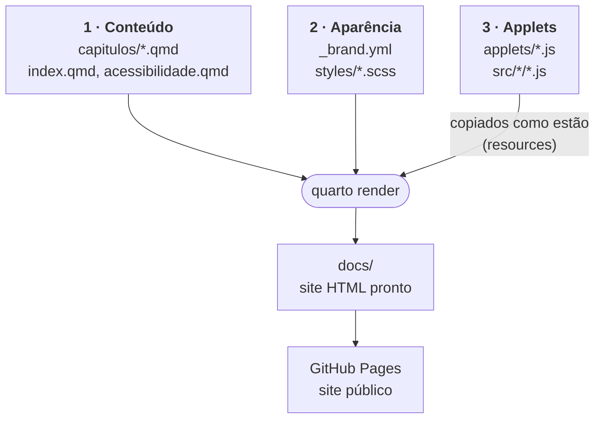
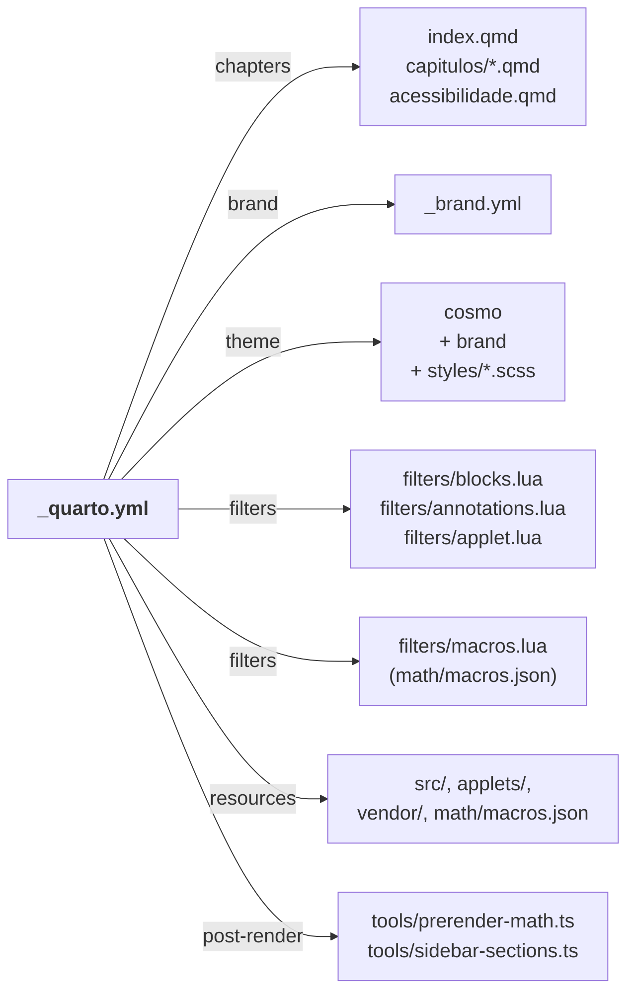
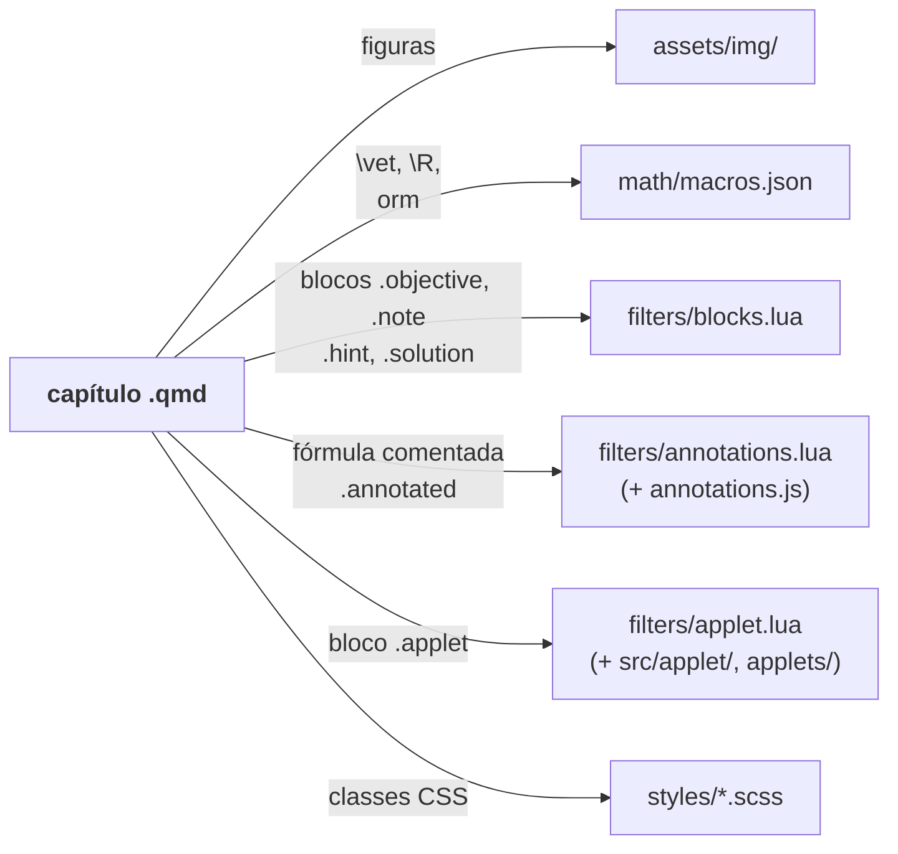
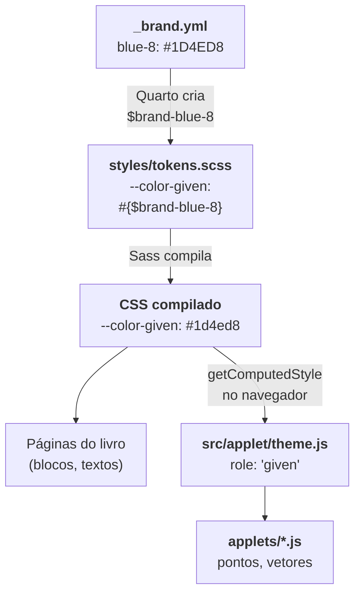
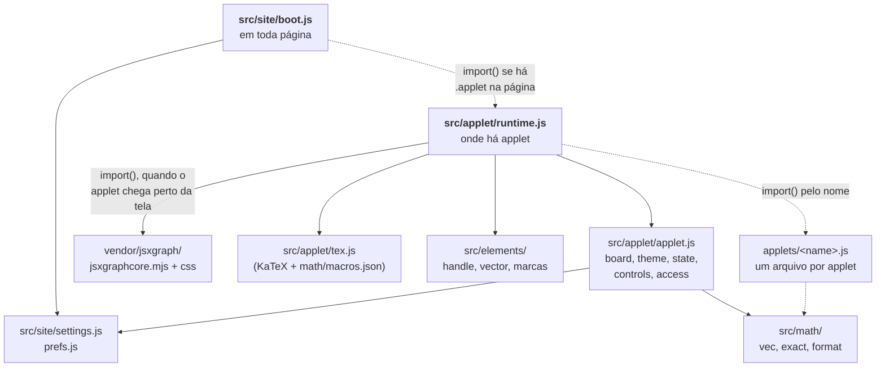
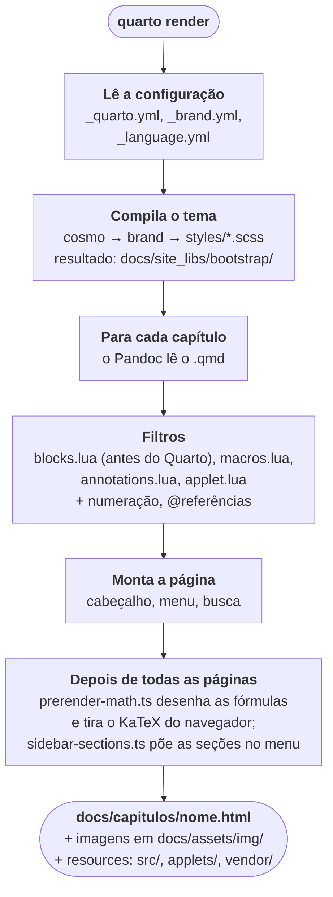
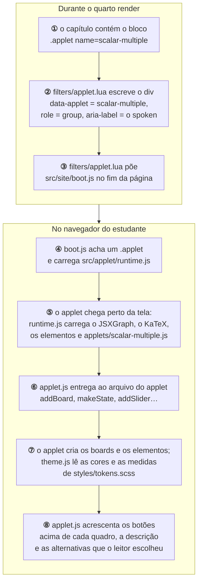
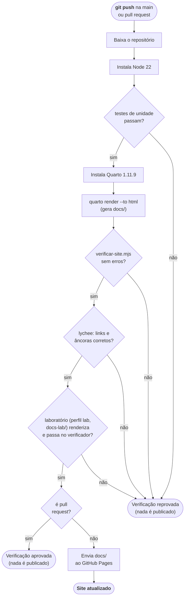
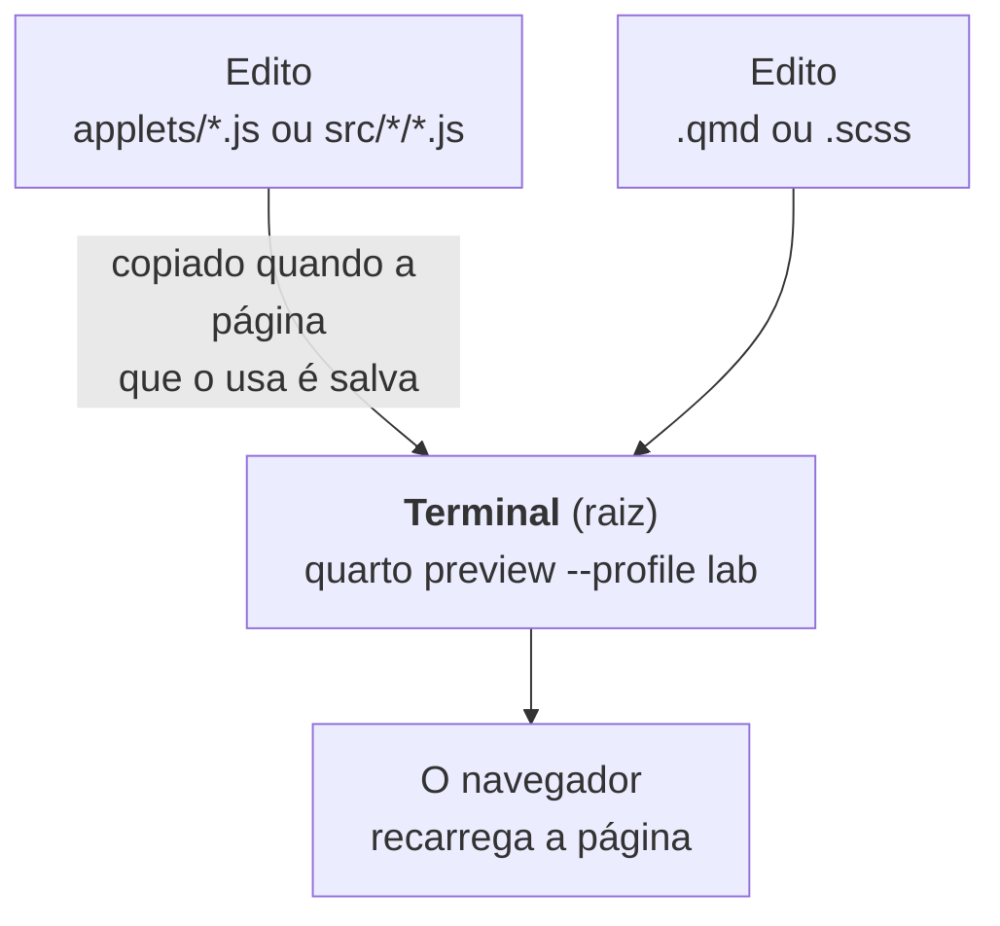

# Mapa arquitetural do projeto

Guia para quem está chegando ao projeto, inclusive quem tem pouca experiência
com desenvolvimento web. Explica **o que cada pasta e arquivo faz**, **como os
arquivos dependem uns dos outros** e **o caminho que o texto de um capítulo
percorre até virar uma página publicada**.

Os diagramas usam [Mermaid](https://mermaid.js.org/): aparecem desenhados no
GitHub e no VS Code com a extensão *Markdown Preview Mermaid Support*.

Este mapa descreve o projeto **como ele é hoje**. Quando o código muda, o mapa
é atualizado na mesma mudança; se os dois divergirem, vale o código.

Documentos relacionados: `README.md` (comandos), `guia-editorial.md` (como
escrever capítulos), `diretrizes-tecnicas.md` (como desenvolver e decidir),
`decisoes.md` (por que as coisas são como são) e `pendencias.md` (o que está
em aberto).

---

## 1. Visão geral em uma frase

Os capítulos são escritos em **Markdown com extensões do Quarto (`.qmd`)**; o
**Quarto** converte esses arquivos em **páginas HTML** (com estilos, fórmulas e
applets) dentro da pasta `docs/`; um **robô do GitHub (GitHub Actions)** faz
isso automaticamente a cada `git push` na `main` e publica o resultado no
**GitHub Pages**. Num pull request, o robô faz as mesmas verificações, mas não
publica.

Há três "linhas de montagem" que se encontram no final:



---

## 2. Glossário mínimo

| Termo | O que é, neste projeto |
|---|---|
| **Quarto** | Programa que transforma `.qmd` em site. Lê a configuração em `_quarto.yml`. |
| **`.qmd`** | Arquivo de texto em Markdown, com fórmulas LaTeX (`$x^2$`) e blocos especiais (`::: {#def-…}`). É onde se escreve o livro. |
| **Pandoc** | Conversor de documentos usado internamente pelo Quarto. Os filtros Lua atuam sobre ele. |
| **Filtro Lua** | Pequeno programa em Lua que modifica o documento durante a conversão (ex.: `filters/blocks.lua`). |
| **Bloco `.applet`** | `::: {.applet name="…" spoken="…"}` dentro do `.qmd`: o lugar de um applet, que `filters/applet.lua` prepara e `src/applet/` monta no navegador. Até a fase 5 da migração (2026-11-25), havia também os shortcodes `` e ``, que saíram. |
| **SCSS / Sass** | CSS com variáveis e regras aninhadas. É compilado para CSS comum pelo Quarto. |
| **Bootstrap / Cosmo** | Biblioteca de estilos usada pelo Quarto; *Cosmo* é o tema-base escolhido. |
| **Variável CSS** (`--color-…`) | Valor definido uma vez em `:root` e reutilizado em todo o site e pelos applets. |
| **JSXGraph** | Biblioteca JavaScript de geometria dinâmica usada nos applets próprios; vem com o site, em `vendor/jsxgraph/`. |
| **Módulo JavaScript** | Um arquivo `.js` que pede outros com `import`. O navegador lê os módulos de `src/` e `applets/` como estão: não há etapa de compilação, nem bundle. |
| **Elemento** | O que `board.create(tipo, pais, atributos)` cria no JSXGraph. Os elementos novos do livro (`handle`, `vector`…) ficam em `src/elements/`. |
| **KaTeX** | Biblioteca que desenha as fórmulas LaTeX. As fórmulas do texto são desenhadas quando o site é gerado (`tools/prerender-math.ts`, depois do render), e não no navegador de cada leitor; o KaTeX só vai ao navegador quando um applet o pede (`src/applet/tex.js`), de `vendor/katex/`, que vem com o site (`html-math-method` em `_quarto.yml`). |
| **GitHub Actions** | Robô que executa `.github/workflows/publish.yml` a cada push na `main` (verifica e publica) e a cada pull request para a `main` (só verifica). |
| **GitHub Pages** | Hospedagem gratuita do GitHub que serve o conteúdo de `docs/` como site. |

---

## 3. Árvore de pastas

Legenda: ✏️ editado à mão · ⚙️ configuração · 🏭 gerado automaticamente (não
editar, não versionado) · 🔒 local (não vai para o Git)

```text
livro-quarto/
├── _quarto.yml                 ⚙️  Configuração central do livro (capítulos, tema, filtros)
├── _quarto-lab.yml             ⚙️  Perfil lab: acrescenta a parte Laboratório e grava em docs-lab/
├── _brand.yml                  ⚙️  Identidade visual: paleta de cores e fontes
├── _language.yml               ⚙️  Traduções de rótulos ("Demonstração", "Solução"…)
├── index.qmd                   ✏️  Página inicial (Apresentação)
├── acessibilidade.qmd          ✏️  O que cada opção do painel de acessibilidade faz
├── README.md                   ✏️  Resumo do projeto e comandos
├── AGENTS.md                   ✏️  Resumo das diretrizes para assistentes de IA
├── cspell.json                 ⚙️  Corretor ortográfico (pt-BR + termos técnicos)
│
├── capitulos/                  ✏️  Um .qmd por capítulo publicado (ordem definida em _quarto.yml)
├── laboratorio/                ✏️  Páginas de teste e modelos de capítulo, só no perfil lab
│                                   (nas duas pastas, _metadata.yml: o caminho do KaTeX)
│
├── filters/
│   ├── macros.lua              ✏️  Filtro: expande as macros em toda fórmula (vem do livro-base)
│   ├── blocks.lua              ✏️  Filtro: rótulos do objetivo e da observação, abas Dica/Solução (vem do livro-base)
│   ├── annotations.lua         ✏️  Filtro: fórmulas comentadas (vem do livro-base)
│   └── applet.lua              ✏️  Filtro: o bloco ::: {.applet} e as partes; põe src/site/boot.js em toda página (vem do livro-base)
├── math/macros.json            ✏️  As macros LaTeX (\vet, \norm, \R…): a lista, lida por todos
├── tools/
│   ├── prerender-math.ts       ✏️  Depois do render: desenha as fórmulas (vem do livro-base)
│   └── sidebar-sections.ts     ✏️  Depois do render: as seções de cada capítulo no menu (vem do livro-base)
│
├── styles/                     ✏️  Estilos próprios do livro, as camadas do tema depois de _brand.yml
│   ├── tokens.scss             ✏️  As cores pelo que significam, as medidas dos applets e as preferências do leitor
│   ├── page.scss               ✏️  A página: grade, cabeçalho, menu, fórmulas, tabelas, figuras
│   ├── blocks.scss             ✏️  Objetivo, observação, exemplos, exercícios, dicas e soluções
│   ├── annotations.scss        ✏️  Fórmulas comentadas: as caixas, os comentários e as linhas
│   ├── applet.scss             ✏️  Applets: o quadro, os botões acima dele, os controles, os campos, os arranjos
│   └── settings.scss           ✏️  O painel de acessibilidade
├── src/                        ✏️  O que roda no navegador, sem compilação (vem do livro-base)
│   ├── site/                   ✏️  O que roda em toda página
│   │   ├── boot.js             ✏️  O painel em toda página, seção atual no menu, ícone que recolhe o menu, abas, nomes em português; carrega o resto onde houver uso
│   │   ├── scrollers.js        ✏️  Fórmula ou tabela que rola dentro da coluna, ao alcance do Tab
│   │   ├── annotations.js      ✏️  Fórmulas comentadas: os comentários em volta da fórmula e as linhas
│   │   ├── settings.js         ✏️  O painel de acessibilidade, os atalhos do Tab e o ícone do cabeçalho
│   │   ├── prefs.js            ✏️  As preferências do leitor, guardadas no navegador
│   │   └── apply-prefs.html    ✏️  No <head>: as preferências e o menu recolhido, antes de a página aparecer; sem JavaScript, as abas abertas
│   ├── applet/                 ✏️  O que roda onde há applet: o quadro, o estado, os controles, as alternativas ao arraste
│   ├── elements/               ✏️  Os elementos novos do JSXGraph: handle, vector, freevector, vectorcopy, marcas
│   └── math/                   ✏️  Contas com vetores, valores exatos e a escrita dos números, sem desenho
├── applets/                    ✏️  Um arquivo por applet; o nome do arquivo é o nome usado no capítulo
│
├── assets/img/<capítulo>/      ✏️  Figuras, uma subpasta por capítulo
│
├── vendor/                     Programas de terceiros que chegam ao estudante, copiados (não editar)
│   ├── VERSIONS.md             ✏️  Versões, licenças e de onde vêm
│   ├── katex/                  KaTeX: script, folha de estilo e fontes das fórmulas
│   ├── jsxgraph/               JSXGraph: o módulo, a folha de estilo e as licenças
│   ├── fonts/                  Fontes do texto e dos títulos, lidas por _brand.yml
│   └── icons/                  Um recorte da fonte de ícones do Quarto, com os ícones que o livro mostra
│
├── tests/
│   ├── verificar-site.mjs      ✏️  Verificação automática das fontes e do HTML gerado
│   ├── unit/                   ✏️  Testes de unidade, do livro-base: a paleta (nenhuma cor se perdeu), as contas das fórmulas comentadas e as de src/math/
│   └── fixtures/               ✏️  A tabela dos nomes das cores, de antes e de agora
│
├── _interno/                   ✏️  Material interno, versionado mas ignorado pelo Quarto (começa com "_")
│   ├── diretrizes/             ✏️  Princípios, guia editorial, diretrizes técnicas, decisões, pendências, este mapa
│   ├── referencia/             ✏️  Material anterior aos Princípios, que não orienta o trabalho atual
│   └── oficina/
│       ├── nao-publicados/     ✏️  Capítulos ainda fora do índice do livro
│       └── references.bib/.qmd ✏️  Bibliografia (ainda inativa)
│
├── .github/
│   ├── workflows/publish.yml   ⚙️  Robô de build e publicação no GitHub Pages
│   └── copilot-instructions.md ⚙️  Regras para o GitHub Copilot
├── .vscode/settings.json       ⚙️  Preferências do VS Code para este projeto
├── .gitignore                  ⚙️  O que o Git não deve versionar
│
├── docs/                       🏭  Site gerado por `quarto render` (é ele que vai ao ar)
├── docs-lab/                   🏭  Site do perfil lab, com o laboratório (não vai ao ar)
├── .quarto/                    🏭  Cache interno do Quarto
├── _scratch/                   🔒  Rascunhos e auditorias descartáveis
└── .claude/                    🔒  Configurações locais do Claude Code
```

**Regra prática:** se a pasta aparece com 🏭, pode ser apagada sem medo — ela é
recriada pelo comando correspondente. Nunca edite arquivos dentro de `docs/`: a
alteração some na próxima geração.

---

## 4. Finalidade de cada arquivo

### 4.1 Configuração do livro (raiz)

| Arquivo | Finalidade | Quem lê |
|---|---|---|
| `_quarto.yml` | Diz ao Quarto: tipo de projeto (`book`), pasta de saída (`docs`), lista e ordem dos capítulos, o KaTeX de `vendor/katex/` (`html-math-method`, e `resources`, que o copia para `docs/`), camadas de tema (só o claro: `brand: light: _brand.yml`; com `brand: _brand.yml`, o Quarto gera também uma folha escura que nenhuma página usa; depois do Cosmo e de `brand`, as folhas de `styles/`), as larguras da página (`grid`) e nenhuma coluna "Neste capítulo" (`toc: false`), o cabeçalho (`book.navbar`: o ícone que recolhe o menu, o título, a busca e, em `right`, o ícone de acessibilidade, um link para `acessibilidade.qmd` que `src/site/settings.js` faz abrir o painel) e o menu (`book.sidebar`), filtros (o das macros, o das fórmulas comentadas, o dos blocos, que roda antes do Quarto, e o dos applets, que também põe `src/site/boot.js` em toda página, num `filters:` de primeiro nível, que vale para qualquer formato), como aparecem dicas e soluções e os rótulos dos blocos (`reveal`, `block-labels`), os passos depois do render (`post-render`: `tools/prerender-math.ts` e `tools/sidebar-sections.ts`), o que as páginas carregam além delas (`resources`: os módulos de `src/`, os applets, o KaTeX, o JSXGraph e `math/macros.json`; o Quarto não acusa um que falte, e o verificador sim), numeração de seções e a faixa de aviso no alto das páginas (`book.announcement`: desde o Quarto 1.11, um livro ignora a faixa de `website`). | Quarto |
| `_brand.yml` | Paleta nomeada, em duas seções: as cores do livro (`blue-2`, `sand-1`…; os nomes do livro-base desde 2026-11-25, com os mesmos valores: `tests/fixtures/livro-colors.json` tem a tabela dos nomes de antes) e as cores de teste, do JSX-quarto (`blue-oi`, `red-tb`…; §5.2); papéis das cores (`primary`, `background`…), fontes (Atkinson Hyperlegible no texto, Source Serif 4 nos títulos), com os arquivos de `vendor/fonts/` (`source: file`), e não do Google, e o tamanho e a entrelinha do texto. O Quarto transforma cada cor da paleta em uma variável SCSS `$brand-<nome>` e numa variável CSS `--brand-<nome>`. | Quarto (camada `brand` do tema) |
| `_language.yml` | Substitui rótulos padrão do Quarto ("Proof" → "Demonstração"). Lido automaticamente por estar na raiz do projeto. | Quarto |
| `capitulos/_metadata.yml`, `laboratorio/_metadata.yml` | O caminho do KaTeX para as páginas dessas pastas (`../vendor/katex/`): o de `_quarto.yml` é relativo à página. Uma pasta nova de páginas precisa do mesmo arquivo. | Quarto |
| `_quarto-axe.yml` | Perfil `axe`: liga a verificação de acessibilidade do Quarto (axe-core) com `quarto preview --profile axe`. O site publicado é gerado sem perfil e não a leva ao estudante. | Quarto |
| `index.qmd` | Primeira página do livro (sem número de capítulo). | Quarto |
| `acessibilidade.qmd` | O que cada opção do painel de acessibilidade faz, com um botão que abre o painel; sem número, depois dos capítulos. O ícone do cabeçalho leva a ela quando o painel não abre (sem JavaScript). Vem do livro-base, igual (desde a fase 6 da migração). | Quarto |
| `cspell.json` | Dicionário e padrões ignorados pelo verificador ortográfico do editor. | Extensão Code Spell Checker |

### 4.2 `capitulos/`

Cada `.qmd` é um capítulo. Só é publicado se estiver listado em `book.chapters`
no `_quarto.yml`. O cabeçalho diz o estado do capítulo (`estado: prototipo` ou
`estado: revisado`; `diretrizes-tecnicas.md`, §1.4), que o verificador lê; a
linha não aparece na página. Um capítulo combina:

- **Markdown** (títulos `##`, listas, ênfase);
- **LaTeX** entre `$…$`, usando as macros de `math/macros.json`;
- **Blocos numerados do Quarto**: `{#def-…}`, `{#prp-…}`, `{#exm-…}`, `{#exr-…}`, referenciados com `@def-…`;
- **Blocos do livro** (desde a fase 7 da migração, os do livro-base): `.objective` e `.note`, com rótulo, e as dicas e soluções em abas, `.hint` e `.solution`, dentro de um exemplo ou exercício;
- **Fórmulas comentadas**: `.annotated`, com `\note{n}{…}` nas partes;
- **Applets**: o bloco `::: {.applet name="…" spoken="…"}`, com as partes `.board`, `.controls` e `.live`, se o capítulo quiser escolher onde elas ficam (`guia-editorial.md`, §6);
- **Figuras** de `assets/img/<capítulo>/`.

### 4.3 `filters/`, `math/` e `tools/` — extensões do Quarto

| Arquivo | Quando roda | O que faz |
|---|---|---|
| `filters/applet.lua` | Na renderização, em todo capítulo, depois dos outros filtros | Normaliza a marcação dos applets: o bloco `.applet` recebe `data-applet` (o `name`), `role="group"` e `aria-label` (o `spoken`); as partes `.board`, `.controls` e `.live` recebem `data-part`, e `[nome]{.live}` fica com reticências no lugar do nome, que é o que se lê sem JavaScript; `cols="…"` vira uma grade (`.cols`, com uma container query). Avisa no render quando falta o `name` ou o `spoken`, ou quando não existe o arquivo do applet. Fora do HTML (no PDF), o applet vira um aviso: "Conteúdo interativo: consulte a versão online do livro". Põe `src/site/boot.js` no fim de toda página HTML, com o caminho a partir dela (`quarto.project.offset`). Vem do livro-base, igual a menos dos comentários. |
| `filters/blocks.lua` | Na renderização, antes dos filtros do Quarto (`at: pre-ast`, porque o Quarto tem um ambiente `.solution` próprio), para qualquer formato de saída | Põe o rótulo do `.objective` e da `.note` ("Objetivo.", "Erro comum."), na linha do texto (`block-labels: run-in`); junta as `.hint` e `.solution` seguidas em abas que começam fechadas (`reveal: tabs`), e cada dica fica com a solução escrita depois dela; no PDF, tudo à vista. O script das abas está em `src/site/boot.js`. Vem do livro-base, igual a menos dos comentários (os três blocos de antes que ele aceitava, `.prerequisites`, `.interaction` e `.pitfall`, saíram de lá em 2026-11-25). |
| `filters/annotations.lua` | Na renderização, em todo bloco `.annotated`, para qualquer formato de saída | Marca cada parte `\note{n}{…}` da fórmula (`\htmlData`, que `tools/prerender-math.ts` aceita) e põe no começo de cada comentário o número e uma cópia da parte; no PDF, a fórmula sem marcas e a lista. Avisa no render quando falta a fórmula, a lista, uma marca ou um comentário. Vem do livro-base, igual. |
| `filters/macros.lua` | Na renderização, em toda fórmula, para qualquer formato de saída | Expande as macros de `math/macros.json` (`\vet`, `\norm`, `\N`, `\Z`, `\Q`, `\R`, `\C`): a fórmula chega ao KaTeX, às prévias das referências cruzadas e ao PDF já em TeX comum. Vem do livro-base, igual. |
| `math/macros.json` | Lido por `filters/macros.lua` e, no navegador, por `src/applet/tex.js` | A lista das macros, em JSON: cada barra invertida do TeX aparece dobrada (`"\\R": "\\mathbb{R}"`), e `#1` é o argumento. |
| `tools/prerender-math.ts` | Depois do render (`post-render`), com o Deno que vem com o Quarto | Troca cada fórmula pelo desenho do KaTeX (`vendor/katex/katex.min.js`) e tira da página o KaTeX do Pandoc: uma página sem applet não carrega JavaScript para a matemática, e o leitor nunca vê TeX cru. Uma fórmula que o KaTeX não desenha para o render (no laboratório, só fica para o KaTeX do navegador). Os applets carregam o KaTeX deles quando precisam (`src/applet/tex.js`). Vem do livro-base, com as diferenças escritas no alto do arquivo. |
| `tools/sidebar-sections.ts` | Depois do render (`post-render`), depois do anterior | Põe no menu lateral de cada página as seções (os títulos `##`) de cada capítulo, como subitens que se recolhem, no lugar da coluna "Neste capítulo"; um título marcado com `.unlisted` fica de fora. É HTML puro (`<details>`) e funciona sem JavaScript; `src/site/boot.js` só marca a seção que está na tela. Numa prévia parcial, só a página salva é refeita. Vem do livro-base, igual. |

### 4.4 `styles/` e `src/site/`

| Caminho | Finalidade |
|---|---|
| `styles/tokens.scss` | As cores pelo que significam (`--color-text`, `--color-accent`, `--color-given`, `--color-result`, `--color-support`, `--color-board`, `--color-grid`…), derivadas de `_brand.yml`, e as medidas dos applets (traços, pontos, nomes; `--point-radius`, `--stroke-normal`…), em px, que `src/applet/theme.js` lê; o site e os applets leem estes nomes. Também as preferências do leitor que mudam esses valores: pontos maiores, contraste alto (que segue o do sistema enquanto o leitor não escolhe) e o tamanho do texto. Tira do Cosmo o pedido da fonte dele ao Google (`$web-font-path: false`). Os nomes são os do livro-base desde 2026-11-25 (eram `--cor-…` e `--applet-…`). |
| `styles/page.scss` | A página: o recorte da fonte de ícones (`vendor/icons/`), a cor do texto e "Mais espaço entre as linhas", o foco, o movimento reduzido (do sistema ou do painel), a opacidade dos títulos menores (contraste), a seta de `\vet` (decisão E6 do livro-base), fórmulas e tabelas largas que rolam dentro da coluna, código no meio do texto que quebra a linha, figuras `.figure-note`, as colunas de `cols="…"` (`.cols`), os atalhos do Tab (`.skip-links`, escondidos até receberem o foco), o cabeçalho (com o ícone de acessibilidade, cujo nome fica só para o leitor de tela), as cores dos links de navegação, a grade da página (as larguras de `grid`, em `_quarto.yml`; decisão E4 do livro-base), o menu recolhido e as seções no menu. |
| `styles/blocks.scss` | O objetivo e a observação, com o rótulo; exemplos e exercícios; as abas das dicas e soluções e as outras três formas de `reveal` (`inline`, `steps`, `accordion`). Vem do livro-base, sem a aparência dos avisos do Quarto (`.callout-…`), que o livro não usa. |
| `styles/annotations.scss` | As fórmulas comentadas: a caixa de cada parte, na cor do seu comentário (`--note-1` a `--note-4`, em `tokens.scss`), os comentários em volta da fórmula, ao lado dela ou numa lista, e as linhas. Vem do livro-base, igual. |
| `styles/applet.scss` | Os applets: só o quadro tem fundo branco e borda fina; os dois botões logo acima de cada quadro; os pontos que se arrastam; os controles, que quebram a linha na ordem do código; os campos para quem não arrasta; os arranjos (`width`, `.center`, `.float-right`, `.board-group`); as marcas que ligam uma palavra do texto a um elemento da figura (`.mark-given`…). Vem do livro-base, sem a parte do apêndice de cores de lá. |
| `styles/settings.scss` | O painel de acessibilidade. Vem do livro-base, igual. |
| `src/site/boot.js` | Roda em toda página (`filters/applet.lua`): marca no menu a seção que está na tela, dá ao ícone que recolhe o menu o nome do que ele faz e a barra de espaço, leva o `<html>` junto quando o menu se recolhe, abre e fecha as abas das dicas e soluções (e "Mais uma dica"), tira dos links de anterior e próximo um nome que não bate com o que está na tela, traduz o nome da busca e, numa página com fórmula comentada, carrega `annotations.js`; numa página com applet, `src/applet/runtime.js`. Põe o painel de acessibilidade em toda página (`initSettings`, de `settings.js`), desde a fase 6 da migração. Vem do livro-base, igual a menos dos comentários. |
| `src/site/annotations.js` | Numa página com fórmula comentada: leva os comentários para perto das partes, ou a lista para o lado da fórmula, onde couber, e desenha as linhas; onde não couber, fica a lista. Refaz tudo quando a largura muda. Vem do livro-base, igual. |
| `src/site/scrollers.js` | Uma fórmula, tabela ou bloco de código mais largo que a coluna rola dentro dela; este módulo o põe ao alcance do Tab, só quando de fato rola. Vem do livro-base, igual. |
| `src/site/settings.js` e `prefs.js` | O painel de acessibilidade e as preferências do leitor: mover os pontos sem arrastar (tocar no destino, campos para digitar), pontos maiores, a descrição em texto à vista, menos movimento, contraste alto, mais espaço entre as linhas e o tamanho do texto. As escolhas ficam guardadas no navegador (`localStorage`) e viram atributos `data-…` no `<html>`; os applets são remontados quando uma delas muda. O painel se abre de três lugares: o ícone do cabeçalho, a segunda parada do Tab ("Abrir as opções de acessibilidade", depois de "Ir para o conteúdo", que toma o lugar do atalho do Quarto) e o botão acima de cada quadro; até a fase 6 da migração, só pelo último. Vêm do livro-base, iguais a menos dos comentários. |
| `src/site/apply-prefs.html` | No `<head>` de toda página (`include-in-header`): aplica as preferências guardadas e marca o menu recolhido antes de a página aparecer, para ela não piscar; sem JavaScript, deixa dicas e soluções à vista, cada uma com o nome. |

### 4.5 `src/applet/`, `src/elements/`, `src/math/` e `applets/` — os applets

O sistema de applets do livro-base, desde a fase 5 da migração (2026-11-25), sem compilação: o navegador lê os módulos como estão. Os arquivos vêm do livro-base, iguais a menos dos comentários; a ficha de cada função e de cada elemento novo está no Apêndice C do livro-base ("Guia de autoria de applets").

| Arquivo | Finalidade |
|---|---|
| `src/applet/runtime.js` | Acha os applets da página e monta cada um quando ele chega perto da tela: só então baixa o JSXGraph, o KaTeX (`tex.js`), os elementos novos e o arquivo do applet, pelo nome (`applets/<name>.js`). Remonta os applets quando uma preferência que os muda é escolhida no painel. Mostra uma mensagem no lugar de um applet que não carregou. Os applets montados ficam em `window.bookApplets`, para o console. |
| `src/applet/applet.js` | O que o arquivo de um applet recebe (`addBoard`, `makeState`, `makeAnimation`, `addSlider`, `addCheckbox`, `addRadio`, `addNumberField`, `addButton`, `addPlayButton`, `addLive`, `addStatus`, `onChange`, `shareScale`, `JXG`) e o que vem pronto: os boards de um applet ligados, os botões de reiniciar e de acessibilidade acima de cada quadro, a descrição para o leitor de tela, as alternativas ao arraste para quem as escolheu, as expressões que não pulam. |
| `src/applet/board.js` | Cria o board: a região do plano dada por números simples, com a mesma escala nos eixos (ou `ratio`, com as escalas livres), o plano parado (sem deslocar nem mudar de escala), o toque que rola a página fora dos pontos; boards ligados; boards com a mesma escala (`shareScale`). |
| `src/applet/theme.js` | Transforma os valores de `styles/tokens.scss` em atributos do JSXGraph: o applet diz um papel (`role: 'result'`) ou, no laboratório, uma cor de `_brand.yml` pelo nome (`color: 'blue-oi'`), e nunca escreve um valor. |
| `src/applet/state.js` | Os valores que o leitor controla (`state.a = 2` redesenha os boards e acerta os controles) e a animação, que só começa a pedido. |
| `src/applet/controls.js`, `icons.js` | Faixas de valores, caixas de seleção, botões de opção, campos, botões; os desenhos dos botões. |
| `src/applet/access.js` | As alternativas ao arraste, montadas a partir dos pontos: campos para as coordenadas, e tocar no ponto e depois no destino. |
| `src/applet/tex.js` | O KaTeX dos applets, com as macros de `math/macros.json`, e as expressões que mudam sem que a linha pule. |
| `src/elements/` | Os elementos novos do JSXGraph (`board.create(tipo, pais, atributos)`): `handle` (o ponto que se arrasta, com a forma que diz isso), `vector`, `freevector` e `vectorcopy`, e as marcas `rightangle`, `measure` e `leaders`. |
| `src/math/` | Contas com vetores (`vec.js`), valores exatos (`exact.js`: frações, raízes, frações de π) e a escrita dos números (`format.js`: `text.*`, para a descrição, e `tex.*`, para as fórmulas), o único lugar do formato dos números (`notation`). Têm testes de unidade (`tests/unit/`). |
| `applets/` | Um arquivo por applet, com o nome usado no capítulo; a exportação padrão é a função que o monta (§7). Hoje: `scalar-multiple.js`, do livro-base (o vetor u e o vetor a·u, com uma faixa de valores, uma caixa e o botão Animar), usado nos modelos e nas páginas Arranjos e Teste dos controles do laboratório, e `color-models.js`, de teste (a soma de vetores em três modelos de cor), na página Teste de cores. Nenhum applet está num capítulo. |

### 4.6 `tests/verificar-site.mjs`

Script Node. Roda sem instalar nada: confere as fórmulas com `vendor/katex/katex.min.js`, o mesmo arquivo que `tools/prerender-math.ts` usa e que os applets carregam. Verifica:

- **nas fontes** (`index.qmd`, `acessibilidade.qmd`, `capitulos/*.qmd` e `laboratorio/*.qmd`): imagens inexistentes, "Definição"/"Proposição" escritas como título em vez de bloco, comandos TeX suspeitos (ex.: `\MATHBB`), cores `\color{…}` sem `#`, blocos que nenhum filtro do livro conhece desde a fase 7 da migração (os de antes, `.bloco-*`, `.dica`, `.solucao`, `.resposta`, `#exrr-…`, `.fig-leg`; os três de antes que o livro-base tinha; os avisos `.callout-…` do Quarto), com a troca na mensagem, também em exemplos de código: uma `.solucao` sairia com a solução à vista; e a marcação dos applets de antes da fase 5 (os shortcodes `applet` e `geogebra`, o bloco com `nome=`, as partes `.quadro`, `.controles` e `.leitura`), também em exemplos de código;
- **no site gerado** (`docs/`; com `--lab`, `docs-lab/`): `iframe` sem `title`, imagem sem `alt` (aviso), applet usado sem arquivo correspondente em `applets/` (ou que não chegou ao site), applet sem `spoken`, o que os applets carregam e não chegou ao site (`resources`), `id` duplicado (fora dos blocos de código), saltos na hierarquia de títulos (aviso), o que a página carrega de outro servidor, no HTML ou nas folhas de estilo locais que ela carrega (`url()` e `@import`; erro também no laboratório, porque vem da configuração do livro);
- **nas fórmulas** do site gerado, que chegam desenhadas (`tools/prerender-math.ts`), com as macros já expandidas (`filters/macros.lua`): o TeX de cada uma, guardado numa anotação, passa de novo pelo KaTeX, e é aviso se tem um caractere que ele não conhece (como `’` no lugar de `'`); uma fórmula que ficou em TeX é erro: ou o KaTeX não a desenha (comando inexistente, macro com nome errado, `\color[HTML]{…}`), ou o post-render não rodou; e é erro uma página que ainda carrega o KaTeX no navegador sem ter fórmula em TeX (o post-render não rodou). O resumo conta as fórmulas;
- **nas cores**, a partir do CSS do tema que as páginas de `docs/` carregam (avisos): as cores dos papéis (`--color-given`, `--color-result`, `--color-support`) e a do texto com contraste abaixo de 3:1 sobre o fundo do quadro (`--color-board`); applet usado no livro que pede uma cor das paletas de teste (`color: 'blue-oi'`);
- **nos protótipos** (`estado: prototipo` no cabeçalho do `.qmd`; a página de `docs/` é ligada à fonte pelo caminho): continua erro o que quebra a página (imagem inexistente, comando TeX suspeito, fórmula que o KaTeX não desenha, `iframe` sem `title`, applet sem arquivo ou sem `spoken`, `id` duplicado); os avisos e a conferência de título de definição ou proposição viram uma linha de contagem ("Em protótipos: N avisos…"), que não reprova nem com `--estrito`. Um valor de `estado` que não seja `prototipo` nem `revisado` gera aviso; sem a linha, a fonte é tratada como revisada.

- **no laboratório** (`laboratorio/`, e as páginas dele em `docs-lab/`): o que o verificador acha é listado à parte ("No laboratório, sem reprovar") e não reprova, nem com `--estrito`: são testes e modelos, alguns com exemplos que não funcionam de propósito (as macros só de `teste.qmd`). Sem `--lab`, uma página do laboratório em `docs/` é erro: ela só entra pelo perfil.

Links internos e âncoras são verificados à parte pelo *lychee*, no workflow, só em `docs/`.

### 4.7 Ferramentas e bastidores

| Arquivo | Finalidade |
|---|---|
| `.github/workflows/publish.yml` | Receita do robô de publicação (ver §5.5). |
| `.github/copilot-instructions.md`, `AGENTS.md` | Resumo das diretrizes para assistentes de IA: que tipo de mudança cada um pode fazer e como verificar (`diretrizes-tecnicas.md`, §9). |
| `.vscode/settings.json` | Formatação de `.qmd` pela extensão Quarto, oculta pastas geradas no Explorer, Copilot só em arquivos de código. |
| `.gitignore` | Impede versionar `docs/`, `.quarto/`, `node_modules/`, `_scratch/`, HTML gerado em `_interno/` etc. |
| `_quarto-lab.yml` | O perfil lab: o Quarto o junta ao `_quarto.yml` com `--profile lab`. Só acrescenta a parte Laboratório (as páginas de `laboratorio/`, uma por linha) e a pasta de saída `docs-lab/`; o resto da configuração é a do livro. Com `--profile lab,axe`, também a verificação de acessibilidade. |

---

## 5. Diagramas

### 5.1 Quem depende de quem (configuração e estilos)

As setas significam "é lido / usado por".



O `_language.yml` não aparece no `_quarto.yml`: o Quarto o lê
automaticamente por estar na raiz do projeto.

E o que cada capítulo usa, conforme o que está escrito nele:



### 5.2 Cadeia das cores: de `_brand.yml` até o applet

Uma cor é definida **uma única vez** e chega ao site e aos applets por este
caminho. Para mudar a cor dos dados, por exemplo, altere a paleta ou o token
— não o JavaScript.



Papéis de cor dos objetos matemáticos (definidos em `styles/tokens.scss`), um
tom cada:

| Token | Cor | Uso pedagógico |
|---|---|---|
| `--color-given` | `blue-8` | O que o estudante controla ou o que o enunciado fornece (ex.: $\vec u$ e $\vec v$ na soma) |
| `--color-result` | `orange-2` | O que o applet calcula a partir dos dados, foco da ideia (ex.: $\vec u + \vec v$) |
| `--color-support` | `gray-5` | Construções que ajudam a ler: cópias, projeções, linhas de chamada (tracejadas) |

Nomes, origem e pontos de referência usam a cor do texto (`--color-text`). Erro
ou contraexemplo não tem cor própria: o elemento recebe `role: 'alert'` (traço
grosso, tracejado curto), e a descrição explica. Dois elementos do mesmo papel
se distinguem pelo nome junto a eles. Com "Contraste alto" no painel (ou no
sistema), os papéis passam a outras cores, também em `styles/tokens.scss`, e os
applets são remontados com elas.

A paleta de `_brand.yml` tem duas seções: as **cores do livro**, as únicas que
os tokens acima usam, e as **cores de teste**, que são as paletas comparadas no
JSX-quarto (Desmos, Okabe–Ito, Tol, IBM Carbon, Dark2), com os nomes de lá:
`<matiz>-<fonte>`, como `blue-oi`. O Quarto cria `--brand-<nome>` para todas.
Um applet de teste chama uma cor pelo nome, com `{ color: 'blue-oi' }`; um applet
usado no livro usa os papéis, `{ role: 'result' }` (`diretrizes-tecnicas.md`, §4.5 e §6).

### 5.3 Dependências entre os arquivos JavaScript



As setas tracejadas mostram onde um applet novo se encaixa: basta criar o
arquivo em `applets/`, porque `runtime.js` o pede pelo nome escrito no capítulo
(`data-applet`). Nada é juntado num arquivo só: cada módulo é um pedido ao
servidor, e `runtime.js` pede os de `src/` de uma vez (`modulepreload`), para
poupar idas e vindas numa conexão lenta.

O JSXGraph **não** é importado por cada applet: `runtime.js` o carrega uma vez,
e cada applet o recebe pelo que `applet.js` lhe dá (`JXG`), junto com
`addBoard`, `makeState` e o resto.

### 5.4 O que acontece em `quarto render` (simplificado)



Os applets não passam por compilação: `resources`, em `_quarto.yml`, copia os
arquivos de `src/`, `applets/`, `vendor/` e `math/macros.json` para `docs/`
como estão.

### 5.5 Como um applet aparece na tela

Exemplo: um capítulo com as linhas
`::: {.applet name="scalar-multiple" spoken="Múltiplo de um vetor"}` e `:::`.



O `name` do bloco precisa ser **igual** ao nome do arquivo do applet
(`applets/scalar-multiple.js`, sem `.js`). Se não for, o render avisa, a página
mostra "Não foi possível carregar este applet" e o verificador acusa erro.

Com partes escritas no capítulo (`[]{.board name="plane"}`, `[]{.controls}`,
`[product]{.live}`), o caminho é o mesmo: em ②, cada parte recebe `data-part`; em
⑦, `addBoard('plane', …)` desenha na parte `plane`, os controles vão para a parte
`.controls` e cada expressão, para a sua `.live`. Sem partes, o applet põe os
quadros que não são opcionais e, logo abaixo, os controles.

### 5.6 Publicação automática (GitHub Actions)



O resultado aparece na página do pull request, no GitHub. Integre o pull
request à `main` só quando a verificação estiver aprovada.

Como `docs/` não é versionado, **o site publicado é sempre gerado do zero pelo
robô**. O que está na sua máquina em `docs/` serve apenas
para pré-visualização.

---

## 6. Trabalho local: qual comando usar

| Quero… | Comando | Onde |
|---|---|---|
| Ver o livro enquanto escrevo | `quarto preview` | raiz |
| Ver o livro com a verificação de acessibilidade do Quarto (axe, no console do navegador) | `quarto preview --profile axe` | raiz |
| Editar um applet e ver no livro | `quarto preview --profile lab`, com o applet numa página do laboratório. A prévia não copia um `.js` salvo: salve também a página que o usa (a prévia a refaz e copia de novo os arquivos de `resources`) | raiz |
| Gerar o site completo | `quarto render` | raiz |
| Rodar as verificações | `node tests/verificar-site.mjs` | raiz |
| Rodar os testes de unidade | `node --test "tests/unit/*.test.mjs"` | raiz |
| Ver as páginas de teste e os modelos de capítulo (laboratório) | `quarto preview --profile lab` (com `--profile lab,axe`, também a verificação de acessibilidade) | raiz |
| Gerar e verificar o laboratório | `quarto render --profile lab --to html` e `node tests/verificar-site.mjs --lab` | raiz |



---

## 7. Receitas comuns

### Adicionar um capítulo
1. Criar `capitulos/<nome>.qmd` com um único título `#`.
2. Incluir `capitulos/<nome>.qmd` em `book.chapters` no `_quarto.yml`, na posição desejada.
3. Imagens em `assets/img/<nome>/`, referenciadas por `../assets/img/<nome>/arquivo.png`.
4. Rodar `quarto preview` e `node tests/verificar-site.mjs`.

### Adicionar um applet JSXGraph
O que o applet deve garantir, a ficha de aceitação e como reescrever um applet
GeoGebra estão em `diretrizes-tecnicas.md`, §4. A ficha de cada função e de cada
elemento novo, com os padrões e os casos, está no Apêndice C do livro-base ("Guia
de autoria de applets"). Os passos técnicos:

1. Criar `applets/<nome>.js`, com o nome em inglês e minúsculas, separado por
   hífens: é o nome usado no capítulo. A exportação padrão recebe o que o applet
   usa e diz só o que é dele; o resto vem pronto (os botões de reiniciar e de
   acessibilidade, a descrição para o leitor de tela, as alternativas ao arraste).
   Nas primeiras linhas, um comentário com o que o applet mostra e as partes que o
   capítulo pode pôr. Esqueleto, do `scalar-multiple.js`:

   ```js
   // O vetor u, com a ponta arrastável, e o vetor a·u, com uma faixa de valores para a.
   // Partes: `plane`; as expressões `product` e `a`; e os controles.

   import { tex, text } from '../src/math/format.js';
   import { scale } from '../src/math/vec.js';

   export default function ({ addBoard, makeState, addSlider, addLive, addStatus }) {
     const s = makeState({ a: 1.5 });
     const plane = addBoard('plane', { spoken: 'Os vetores u e a vezes u', region: [-5, 4, 5, -4], axis: true, grid: true });
     const U = plane.create('handle', [2, 1], { arrowTip: true, spoken: 'ponta de u', caption: '$\\vec{u}$', snapToGrid: true });
     const u = () => [U.X(), U.Y()];
     const au = () => scale(s.a, u());

     plane.create('vector', [[0, 0], au], { role: 'result', name: 'a\\vec{u}', side: 'right' });
     plane.create('vector', [[0, 0], U], { name: '\\vec{u}' });

     addSlider('a', { min: -2, max: 2, step: 0.1 });
     addLive('product', () => `a\\vec{u} = ${tex.point(au())}`);
     addStatus(() => `a = ${text.number(s.a)}, u = ${text.point(u())} e a vezes u = ${text.point(au())}.`);
   }
   ```

   A figura, a expressão e a descrição leem a mesma conta (regra fundamental 1).
   Os valores iniciais do `makeState` e dos pontos são também os do reinício.
2. Testar numa página de `laboratorio/` (listada em `_quarto-lab.yml`), com
   `quarto preview --profile lab`; com `show="fields"` (ou `"tapMove"`) no bloco,
   a página mostra a alternativa ao arraste sem mexer nas preferências do leitor.
3. `quarto render --profile lab --to html` e `node tests/verificar-site.mjs --lab`.
4. No capítulo, com a instrução num parágrafo antes:
   `::: {.applet name="<nome>" spoken="Nome para o leitor de tela"}` e `:::`
   (`guia-editorial.md`, §6).

### Adicionar um applet com várias partes
Quadros ligados e expressões em lugares diferentes da página: o mesmo arquivo,
com um `addBoard` por quadro e um `addLive` por expressão, cada um com o nome da
parte. Um quadro que o capítulo pode deixar de fora leva `optional: true`, e
`addBoard` devolve `null` quando ele não está na página:

```js
const line = addBoard('number', { spoken: 'O número a na reta numérica', optional: true, region: [-2.5, 1, 2.5, -1] });
if (line) line.create('point', [() => s.a, 0], { color: 'given', name: 'a', withLabel: true });
```

Os boards de um applet se redesenham juntos; os que mostram o mesmo plano levam
`shareScale(a, b)`. No capítulo, as partes (`[]{.board name="number"}`,
`[product]{.live}`) e os arranjos estão no `guia-editorial.md`, §6, e na página
Arranjos do laboratório.

### Adicionar controles a um applet
Faixas de valores, caixas de seleção, botões de opção, campos e botões, ligados
ao estado (`makeState`), na ordem em que devem aparecer, que é também a do Tab:

```js
const s = makeState({ a: 1.5, showLine: false });
addSlider('a', { min: -2, max: 2, step: 0.1 });
addCheckbox('showLine', { caption: 'mostrar a reta de $\\vec{u}$' });
addPlayButton(makeAnimation('a', { min: -2, max: 2, speed: 1 }));
plane.create('line', [[0, 0], U], { role: 'support', visible: () => s.showLine });
```

O nome lido pelo leitor de tela vem do nome do valor (`a`) ou do `caption`, em
texto simples. Um campo de digitar ao lado da faixa de valores não se escreve:
quem prefere digitar o escolhe no painel. Por padrão, os controles ficam logo
abaixo dos quadros; o capítulo os põe em outro lugar com `[]{.controls}`.

### Mudar uma cor
- Cor do tema (fundo, links, títulos): papel ou paleta em `_brand.yml`.
- Cor de um papel dos applets (site e applets): token `--color-…` em `styles/tokens.scss`, e a do contraste alto, logo abaixo, no mesmo arquivo. O verificador avisa se um papel cair abaixo de 3:1 sobre o quadro.

### Testar cores num applet
1. Escreva o applet em `applets/` e peça as cores pelo nome da paleta de `_brand.yml`: `{ color: 'blue-oi' }`, junto do papel, que dá o traço (`{ role: 'result', color: 'teal-oi' }`). Valem as cores do livro (`orange-2`) e as de teste (`red-tb`, `purple-cb`…).
2. Use o applet numa página de `laboratorio/` (listada em `_quarto-lab.yml`) e veja-a com `quarto preview --profile lab`.
3. Um nome errado não acha a variável `--brand-…` e deixa o elemento sem a cor pedida: confira na página.
4. Antes de o applet ir para um capítulo, troque as cores pelos papéis (`role`); se a cor testada deve ficar, isso é uma decisão (`diretrizes-tecnicas.md`, §6). O verificador avisa se um applet de capítulo pedir uma cor das paletas de teste.
5. Para comparar modelos de cor, use a página `teste-cores.qmd`: as cores de cada modelo estão na lista `models` de `applets/color-models.js`.

### Criar um novo tipo de bloco didático
Antes, ver se uma `.note` com outro título não basta: o título diz o que o trecho é,
e não há uma lista fixa de tipos de aviso.
1. Rótulo em `labels` de `filters/blocks.lua`.
2. Estilo em `styles/blocks.scss`, junto ao `.objective` e à `.note`.
3. Documentar em `_interno/diretrizes/guia-editorial.md` e acrescentar aos
   modelos de `laboratorio/`.
4. Registrar a decisão em `decisoes.md` (`diretrizes-tecnicas.md`, §2). O filtro vem
   do livro-base: um bloco novo vale também lá, ou fica como diferença escrita no
   alto do arquivo.

---

## 8. Pontos de atenção

- **O laboratório é o mesmo livro.** `_quarto-lab.yml` só acrescenta a parte Laboratório e a pasta `docs-lab/`; tema, filtros e macros vêm de `_quarto.yml`, sem cópia. Por isso, um rótulo (`#def-…`, `#exr-…`) de um capítulo igual a um de `laboratorio/` se repete no perfil lab: ao copiar um modelo para `capitulos/`, troque os rótulos.
- **Nome do applet = nome do arquivo.** `runtime.js` pede `applets/<name>.js` pelo `name` escrito no capítulo, e o verificador usa a mesma regra. Código que dois applets usam não fica em `applets/`: vai para `src/` (um elemento novo, em `src/elements/`, só se dois applets precisarem dele e ele significar uma ideia só).
- **Os arquivos de `resources`.** O Quarto copia para `docs/` o que `resources` lista, sem acusar o que falta; sem `math/macros.json` ou sem o JSXGraph, nenhum applet aparece. O verificador confere que chegaram. Os padrões começam com `/`: sem a barra, `docs/` iria parar dentro de `docs-lab/`.
- **Nomes lidos diferentes.** O JSXGraph faz de cada quadro uma região com nome; dois quadros com o mesmo nome na mesma página confundem quem navega pelo leitor de tela (o axe acusa).
- **Applets e KaTeX.** As fórmulas do texto saem desenhadas (`tools/prerender-math.ts`), e o KaTeX do Pandoc sai das páginas; os nomes dos elementos, as expressões e os rótulos dos controles dos applets são desenhados no navegador, pelo KaTeX que `src/applet/tex.js` carrega quando um applet chega perto da tela, com as macros de `math/macros.json` (passadas a cada desenho, sem mexer no KaTeX). Uma expressão escrita pelo applet só cresce enquanto o leitor mexe, para que a linha não pule.
- **Cores e medidas lidas na montagem.** `src/applet/theme.js` lê as variáveis CSS quando o applet é montado; uma preferência do painel que as muda (pontos maiores, contraste alto, tamanho do texto) remonta os applets, com o que o leitor já fez.
- **Toque.** No quadro, o dedo fora dos pontos rola a página, e sobre um ponto o arrasta (`src/applet/board.js`): um applet que crie o board sem `addBoard` perde esse cuidado.
- **Depuração no navegador.** No console, `bookApplets` (um `Map`) tem os applets montados da página, com o estado e os boards de cada um.
- **A prévia e os arquivos `.js`.** `quarto preview` não copia de novo um arquivo de `src/` ou `applets/` que foi salvo: salve também a página que o usa, ou rode `quarto render`.
- **`docs/` acumula arquivos antigos** (vários `bootstrap-*.min.css`) entre renderizações locais. É normal; o robô publica a partir de uma pasta limpa. Para limpar localmente, apague `docs/` e renderize de novo.
- **Pastas com `_` no início** (`_interno/`, `_scratch/`) são ignoradas pelo Quarto; por isso o material interno não aparece no site.
- **Erros de SCSS.** Quando a compilação do tema falha, o Quarto pode deixar na raiz um arquivo `_quarto_internal_scss_error.scss` para diagnóstico. Ele é temporário, está no `.gitignore` e pode ser apagado depois de corrigido o erro.
