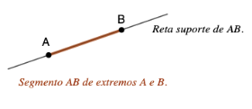
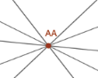

# Título do Capítulo

<!--
Modelo de capítulo com a estrutura atual (guia-editorial.md §3 e §9; página-modelo:
capitulos/segmentos.qmd) e TODOS os tipos de bloco disponíveis no livro.

Como usar: copiar para capitulos/nome.qmd, listar em _quarto.yml, substituir os
[colchetes] e apagar o que não se aplica: ordem e presença dos componentes variam com o
conteúdo. Os rótulos {#def-…}, {#prp-…}, {#exrr-…}, {#fig-…} são globais e devem ser únicos.
Ao copiar para capitulos/, trocar os caminhos ../../../assets/ por ../assets/.
Navegação anterior/próxima é gerada pelo livro; não escrever links de navegação.

Renderizar este teste: quarto render _interno/oficina/testes/modelo-capitulo-completo.qmd
-->

::: {.bloco-objetivo}
[Verbo] [conceito central]; [verbo] [segunda habilidade].
:::

::: {.bloco-pre-requisitos}
[Pré-requisito] ([Capítulo anterior](primeiras-nocoes.qmd)).
:::

## Primeira seção

[Parágrafo de introdução, aproximando a notação verbal da notação matemática.]

::: {#def-modelo-conceito}
O **[nome do conceito]** é [definição precisa].
:::

::: {#def-modelo-com-titulo}
## [Nome do conceito, opcional]

O **[outro conceito]** é [definição].
:::

Pela @def-modelo-conceito, [consequência].

::: {.fig-leg #fig-modelo}
{fig-alt="[Descrição da imagem para quem não a vê.]"}

[Legenda: o que a figura significa no texto.]
:::

::: {.fig-leg .w30 #fig-modelo-estreita}
{fig-alt="[Descrição da imagem.]"}

[Legenda de figura com largura reduzida (.w30 … .w80).]
:::

Na @fig-modelo, [comentário].

::: {.bloco-erro}
Não confunda [A] com [B]: [explicação da distinção e correção].
:::

## Resultados

::: {#prp-modelo-resultado}
## [Nome do resultado, opcional]

Se [hipótese], então [tese].
:::

De fato, [demonstração em texto corrido, fora do bloco].

::: {#thm-modelo-teorema}
[Enunciado do teorema.]
:::

::: {#lem-modelo-lema}
[Enunciado do lema.]
:::

::: {#cor-modelo-corolario}
[Enunciado do corolário.]
:::

::: {.proof}
[Demonstração em bloco, quando preferível.] Veja @lem-modelo-lema e @prp-modelo-resultado.
:::

## Exemplo e prática

::: {#exm-modelo-exemplo}
[Enunciado e resolução do exemplo.]
:::

::: {#exr-modelo-exercício}
[Enunciado de exercício com uma dica.]

::: {.dica}
[Pista que não entrega a resposta.]
:::
:::

::: {#exrr-modelo-resolucao}
[Enunciado de exercício resolvido com resolução simples.]

::: {.solucao}
1. [Primeiro passo.]
2. [Conclusão.]
:::
:::

::: {#exrr-modelo-dica-resolucao}
[Enunciado de exercício resolvido com dica e resolução.]

::: {.dica}
[Pista que não entrega a resposta.]
:::

::: {.solucao}
[Resolução.]
:::
:::

::: {#exrr-modelo-varias-abas}
[Enunciado de exercício com duas dicas e duas resoluções.]

::: {.dica}
[Primeira pista.]
:::

::: {.dica}
[Segunda pista, mais próxima da resposta.]
:::

::: {.solucao}
[Primeira resolução.]
:::

::: {.solucao}
[Resolução alternativa.]
:::
:::

## Exploração interativa

::: {.bloco-interacao}
**[Título do applet].** [Objetivo em uma frase.]

Arraste os pontos [ … ] com o mouse ou o dedo. Pelo teclado, use Tab para selecionar um ponto e as setas para movê-lo. [Estado relevante] aparece em texto abaixo do quadro.


:::

[Pergunta de observação logo depois do applet.]

<!--
Applets GeoGebra (shortcode geogebra) ficam só nos capítulos que ainda não têm a
versão JSXGraph e não entram em capítulos novos sem decisão do autor
(diretrizes-tecnicas.md, §4).
-->

::: {.bloco-checkpoint}
[Pergunta conceitual breve.]

(A) [alternativa]
(B) [alternativa]
(C) [alternativa]

::: {.resposta}
**Resposta correta: (B).** [Explicação.]
:::
:::

## Callouts

::: {.callout-note title="Nota"}
[Observação complementar.]
:::

::: {.callout-tip title="Dica"}
[Sugestão.]
:::

::: {.callout-warning title="Aviso"}
[Aviso.]
:::

::: {.callout-caution title="Cuidado"}
[Cuidado.]
:::

::: {.callout-important title="Importante"}
[Destaque.]
:::

## Síntese

| Conceito | Representação simbólica | Ideia principal |
|:---|:---|:---|
| **[Conceito 1]** | $[\ldots]$ | [Ideia em uma frase.] |
| **[Conceito 2]** | $[\ldots]$ | [Ideia em uma frase.] |
