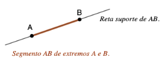
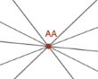

# Título do Capítulo

<!--
Modelo de capítulo com a estrutura atual (guia-editorial.md §3) e TODOS os tipos de bloco
disponíveis no livro, na sintaxe do Apêndice B do livro-base (desde a fase 7 da migração).
É a referência de forma até o primeiro capítulo revisado (§9).

Como usar: copiar para capitulos/nome.qmd, listar em _quarto.yml, substituir os
[colchetes] e apagar o que não se aplica: ordem e presença dos componentes variam com o
conteúdo. Os rótulos {#def-…}, {#prp-…}, {#exr-…}, {#fig-…} são globais e devem ser únicos,
também entre o capítulo e esta página, que o perfil lab põe no mesmo livro.
Navegação anterior/próxima é gerada pelo livro; não escrever links de navegação.

Ver este teste: quarto preview --profile lab (_quarto-lab.yml)
-->

::: {.objective}
[Verbo] [conceito central]; [verbo] [segunda habilidade]. Antes de começar: [pré-requisito] ([Capítulo anterior](../index.qmd)).
:::

## Primeira seção

[Parágrafo de introdução, aproximando a notação verbal da notação matemática.]

::: {#def-modelo-conceito}
O **[nome do conceito]** é [definição precisa].
:::

::: {#def-modelo-com-titulo}
## [Nome do conceito, opcional]

O **[outro conceito]** é [definição].
:::

Pela @def-modelo-conceito, [consequência].

::: {.figure-note #fig-modelo}
{fig-alt="[Descrição da imagem para quem não a vê.]"}

[Legenda: o que a figura significa no texto.]
:::

::: {.figure-note .w30 #fig-modelo-estreita}
{fig-alt="[Descrição da imagem.]"}

[Legenda de figura com largura reduzida (.w30 … .w100).]
:::

Na @fig-modelo, [comentário].

::: {.note title="Erro comum"}
Não confunda [A] com [B]: [explicação da distinção e correção].
:::

## Resultados

::: {#prp-modelo-resultado}
## [Nome do resultado, opcional]

Se [hipótese], então [tese].
:::

De fato, [demonstração em texto corrido, fora do bloco].

::: {#thm-modelo-teorema}
[Enunciado do teorema.]
:::

::: {#lem-modelo-lema}
[Enunciado do lema.]
:::

::: {#cor-modelo-corolario}
[Enunciado do corolário.]
:::

::: {.proof}
[Demonstração em bloco, quando preferível.] Veja @lem-modelo-lema e @prp-modelo-resultado.
:::

## Exemplo e prática

::: {#exm-modelo-exemplo}
[Enunciado e resolução do exemplo.]
:::

::: {#exr-modelo-exercício}
[Enunciado de exercício com uma dica.]

::: {.hint}
[Pista que não entrega a resposta.]
:::
:::

::: {#exr-modelo-resolucao}
[Enunciado de exercício resolvido com solução simples.]

::: {.solution}
1. [Primeiro passo.]
2. [Conclusão.]
:::
:::

::: {#exr-modelo-dica-resolucao}
[Enunciado de exercício resolvido com dica e solução.]

::: {.hint}
[Pista que não entrega a resposta.]
:::

::: {.solution}
[Solução.]
:::
:::

::: {#exr-modelo-varias-abas}
[Enunciado de exercício com duas dicas e duas soluções. Cada dica vale para a solução escrita logo depois dela: aqui, as duas valem para a primeira.]

::: {.hint}
[Primeira pista.]
:::

::: {.hint}
[Segunda pista, mais próxima da resposta.]
:::

::: {.solution}
[Primeira solução.]
:::

::: {.solution}
[Solução alternativa.]
:::
:::

## Exploração interativa

**[Título do applet].** [Objetivo em uma frase.]

Arraste os pontos [ … ] com o mouse ou o dedo. Pelo teclado, use Tab para selecionar um ponto e as setas para movê-lo. [Estado relevante] aparece em texto abaixo do quadro.

::: {.applet name="scalar-multiple" spoken="[Nome do applet para o leitor de tela]"}
:::

[Pergunta de observação logo depois do applet.]

<!--
O applet de exemplo é o scalar-multiple, de applets/: num capítulo, `name` é o
nome do arquivo do applet, sem o .js, e `spoken` é o nome que o leitor de tela diz.
O GeoGebra saiu na fase 5 da migração (diretrizes-tecnicas.md, §4).
-->

::: {#exr-modelo-pergunta}
[Pergunta conceitual breve.]

(A) [alternativa]
(B) [alternativa]
(C) [alternativa]

::: {.solution}
**Resposta correta: (B).** [Explicação.]
:::
:::

## Observações

::: {.note}
[Observação complementar.]
:::

::: {.note title="Dica"}
[Sugestão.]
:::

::: {.note title="Aviso"}
[Aviso.]
:::

::: {.note title="Cuidado"}
[Cuidado.]
:::

::: {.note title="Importante"}
[Destaque.]
:::

## Síntese

| Conceito | Representação simbólica | Ideia principal |
|:---|:---|:---|
| **[Conceito 1]** | $[\ldots]$ | [Ideia em uma frase.] |
| **[Conceito 2]** | $[\ldots]$ | [Ideia em uma frase.] |
